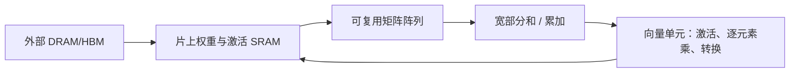

# 经典 GPU/ASIC 怎样做 SwiGLU，以及本项目怎样选择概率 FFN 架构

2026-10-17；Issue #7 / PR #8；负责人 jieruiz。本文接续[现有 FFN 调度与 CIM 仿真审计](FFN_CIM_SCHEDULING_AND_SIMULATION_ZH_20261017.md)。

**建议采用“共享概率矩阵阵列＋片上缓冲＋小型数字 SwiGLU 单元”的阶段式架构作为首个可信基线。它与经典加速器的模块组织一致；是否值得进一步分块流水，用固定资源下的能量、面积和延迟决定。没有完整跨阶段流水，并不表示架构错误。**

## 1. 先分清数学分支、软件算子和物理硬件

数学上有三组权重：`g=Wg*x`、`u=Wu*x`、`y=Wd*(SiLU(g)*u)`。

但同一套矩阵硬件可以先后加载不同权重；两条分支也可以拼成一个更宽的矩阵：

\[
\begin{bmatrix}g\\u\end{bmatrix}=\begin{bmatrix}W_g\\W_u\end{bmatrix}x.
\]

所以，“g/u 同时计算”“合成一次矩阵调用”“两套永久专用物理阵列”是三件不同的事。物理并发要付面积、存储端口和输入分发的成本。

固定总阵列数 P，把资源分为 P/2 算 g、P/2 算 u，与 P 个阵列一起计算合并矩阵，理想算术服务量相同；实际差别在分块、利用率和存储。若给 g/u 各配 P 个阵列，那是增加了总资源，不能当作免费调度收益。

## 2. GPU 的典型路径

| 实现方式 | 执行过程 | 应怎样理解 |
|---|---|---|
| 朴素实现 | gate GEMM、up GEMM、SiLU/乘 u、down GEMM 分别提交 | 数学关系直观，但有多次 kernel 和中间张量 |
| vLLM Qwen2 示例 | 合并 gate/up 矩阵 → `SiluAndMul` → down 矩阵 | 逻辑两支合成宽矩阵；SiLU 与乘 u 在一个逐元素核中；不等于完整 FFN 单核融合 |
| 支持的进一步融合 | 首次 GEMM 的尾部直接做 SwiGLU | 减少提交和中间访问；依赖数据布局、精度、硬件和库支持 |

实际官方代码证据是 vLLM v0.12.0 的 `Qwen2MLP`：`MergedColumnParallelLinear(hidden,[intermediate]*2)`，forward 为 `gate_up_proj → act_fn → down_proj`。[固定版本源码](https://github.com/vllm-project/vllm/blob/v0.12.0/vllm/model_executor/models/qwen2.py#L69-L102)

`SiluAndMul` 等价于对前半张量做 SiLU，再乘后半；CUDA 核把这些逐元素步骤合并，避免单独物化 sigmoid/SiLU 中间向量。输出 z 仍是供 down 使用的张量，不能据此宣称没有显存层次流量，也不能把每个逻辑访问都直接算成 HBM 访问。[激活实现](https://github.com/vllm-project/vllm/blob/v0.12.0/vllm/model_executor/layers/activation.py#L55-L86)、[CUDA 核](https://github.com/vllm-project/vllm/blob/v0.12.0/csrc/activation_kernels.cu#L10-L80)

NVIDIA cuDNN 的实验性 SM100 GEMM＋SwiGLU 接口是融合实例，但仍输出完整 GEMM 结果 AB12 和 SwiGLU 输出 C；不包含后续 Wd，也不是所有 GPU/布局都可用，不能自动套到现有 RTX 5090。[官方接口及限制](https://docs.nvidia.com/cudnn/latest/fe-oss-apis/gemm_fusions/gemm_swiglu/)

还要分开 prefill 与 batch-one decode：前者有多个输入 token，更容易组成大 GEMM 并复用权重；后者接近矩阵向量计算，更容易受权重读出和存储带宽限制。不能只用 Tensor Core 峰值估计单 token 速度。[NVIDIA 矩阵性能说明](https://docs.nvidia.com/deeplearning/performance/dl-performance-matrix-multiplication/index.html)

## 3. 常见 ASIC 的模块组织

公开架构中常见的是：外部存储 → 片上 SRAM/权重缓冲 → 矩阵阵列/宽累加器 → 向量/激活单元 → 片上缓冲。具体单元数量、数据流与调度因芯片而异。



| 原始资料 | 说明的经典做法 | 使用限制 |
|---|---|---|
| TPU 官方架构 | 矩阵 MXU、向量单元、标量控制分工；向量单元负责激活、softmax 等 | 是通用结构证据，不是在声称所有 TPU 都按某个固定 SwiGLU 流水执行 |
| Gemmini | WS/OS 阵列、banked scratchpad、独立 accumulator；load/execute/store 可解耦并重叠 | 原生激活以 ReLU/ReLU6 为例，不是开箱即用 SwiGLU |
| NVDLA | MAC/累加结果进入 SDP，后者有 LUT 非线性和逐元素乘法 | CNN 时代架构示例，不能等同全部现代 LLM ASIC |

来源：[TPU 官方说明](https://docs.cloud.google.com/tpu/docs/system-architecture-tpu-vm)、[Gemmini 官方架构](https://github.com/ucb-bar/gemmini#architecture)、[NVDLA 官方规范](https://nvdla.org/hw/v1/hwarch.html)。

因此，保留一个小型数字 SiLU/乘法单元是成熟的结构选择。概率计算的研究重点可以放在耗能或占面积的大矩阵与注意力，是否继续概率化小单元由实测成本和精度决定。

## 4. 给本项目选择三种候选，不同时展开所有可能性

| 候选 | 物理资源及调度 | 优点 | 风险 / 当前建议 |
|---|---|---|---|
| A：共享阵列、按阶段执行 | 同一概率阵列池先算合并 g/u，数字 SwiGLU 后再算 Wd | 控制清楚，资源可复用，容易复核；与当前方向一致 | 保留完整中间结果；作为必须有的基线 |
| B：共享阵列、优化局部数据通路 | 阵列池不拆分；融合恢复、SiLU/乘法/重编码；局部宽部分和和短缓存 | 主要减少 SRAM 和格式接口开销，不免费增加矩阵硬件 | 优先验证；数字后处理可小流水，但不等于矩阵之间已经并行 |
| C：GU 与 down 阵列分区并行 | 先完成一组中间通道，再向下游流动；两阶段分别有阵列 | 有机会提高并发和降低中间容量 | 分区后利用率下降；多前端/缓冲/带宽；作为后续候选，不默认更快 |

一个 g 通道必须先完成全部输入维度的归约，才能做 SiLU。不能对每个尚未完成的部分和分别做非线性后再相加。若输出尺度要先求全向量最大值，也会阻碍通道流式执行；固定预校准尺度能减少这种屏障。

小单元内部的流水、DRAM 装载与计算的重叠、GU/down 同时运行，以及不同请求/层之间的流水，是不同层次的并发；应分别计资源和延迟，不能共用一个“流水线加速倍数”。batch-one 自回归生成的下一个 token 依赖当前 token，不能直接照搬多请求吞吐收益。

## 5. 同资源的简单算术检查：流水确实可能更慢

使用 Qwen2.5-0.5B 的 h=896、m=4864、24 层；64×64 阵列；100 MHz；T=4096。只算采样服务，不计访存、非线性、输入重编码、额外随机源、缓存和互连成本。

| 总阵列数 | A 每层波次 | C 枚举范围内最短波次 | A 纯服务 ms/token | C 纯服务 ms/token |
|---|---:|---:|---:|---:|
| 8 | 418 | 532 | 411.011 | 523.105 |
| 16 | 216 | 270 | 212.388 | 265.486 |
| 32 | 146 | 144 | 143.559 | 141.592 |
| 64 | 118 | 90 | 116.027 | 88.495 |

枚举所有正的 GU/down 引擎分配，以及中间通道块为 64×{1,2,4,8,16,32,64,76}。**这不是所有架构的最优搜索，也不是完整 TLM。** C 甚至把额外开销设为 0，且默认有足够中间队列，仍可比 A 慢；64 阵列的结果则说明扩大资源后，合适分区可能帮助利用闲置槽位，需进一步验证。

每一通道块均先完成 g/u 归约，再启动 down；前后独立分区无重叠占用。工具检查这些依赖。结果见 [resource_schedule_comparison.json](results/ffn_schedule_audit_20261017/resource_schedule_comparison.json)，重跑：

```sh
python architecture_tlm/compare_ffn_resource_schedules.py --evidence work/jieruiz/7/evidence.json --output new-resource-comparison.json
```

T 降低会直接改变服务时间。例如 A 的 8 阵列在 T=1024/256 时分别约 102.828/25.782 ms/token。**它们是否达到同样 PPL 尚未在本任务验证；不能把服务时间当作整机速度。**

历史合成 2K DRAMSys/TLM 中，总时间约 498.086 ms/token，FFN 约 431.096 ms，其他阶段约 66.990 ms，其中 lm_head 约 45.062 ms。即使改善 FFN，当前数字投影和权重读出仍需优化。此处只提取历史时间；没有新 DRAMSys/真实模型跑分，不认证旧 DRAM 能量。不能把这 67 ms 当其他未来架构的物理下界。

## 6. 怎样证明“我们的架构是对的”

应分别证明三件事，而不是以“像经典 ASIC”代替验证：

1. **算得对：** 编码、符号、缩放、计数/归约和非线性明确；精确计数仅说明没有丢失事件，不表示有限采样等于准确实数乘法。改动后以匹配 BF16 与至少三随机种子验证模型质量。
2. **做得到：** SRAM 端口/容量、驻留权重的可达性、部分和位宽、队列、前后依赖和共享资源没有冲突；用 RTL/实际宏接口校核 TLM，不假设免费存储或并发。
3. **有价值：** 在明确的质量、面积与延迟约束下，每 token 能量更低；同时计随机源、比较、分发、转换、存储和时钟。平均功率低但多运行几十倍，并不能自动说明能效更高。

建议比较矩阵如下，避免把普通 ASIC 相比 GPU 的收益全归给概率计算：

| 基线/候选 | 用来回答什么 |
|---|---|
| 原始 GPU BF16 | 对现有部署的整机延迟与能量是否有实用价值 |
| 同工艺、同存储条件的确定性 ASIC | 单靠 ASIC/量化能省多少；概率矩阵本身还带来什么 |
| 同条件概率 FFN＋准确 attention | 隔离 FFN 效果 |
| 同条件确定性 FFN＋概率 attention | 隔离 attention 效果 |
| 同条件概率 FFN＋概率 attention | 完整组合是否满足质量、面积、延迟预算 |

能效评价优先使用 `mJ/token`，同时报告 `ms/token / tokens/s` 与 `mm²`；能量延迟乘积可作辅助，不能代替单独的速度门槛。尚未约定业务速度时，可先以 10/20/50 ms/token 做设计筛选档位，它们是示例约束，不是用户已确认的验收值。

选型顺序是：先排除质量不合格、超过面积或速度上限的候选，再在剩余候选中比较每 token 能量。若某方案能量、面积、延迟三项都比另一个差，就先淘汰；若各有优势，则保留折中曲线，不强行称一个全局最优。若同条件的确定性低位宽矩阵更省能更快，应缩小随机计算范围，把概率资源放到真正受益的 FFN 子路径或 attention 采样，而不是强行保留全面随机化。

本项目可以准确表述为：**在经典片上存储和可复用计算框架中，用概率矩阵与采样注意力替换重点算子，保留数字控制、宽累加和必要的非线性，探索质量/能量/面积/延迟的折中。**不需要为了形式统一强行把所有模块变成随机比特流。

整机比较还要统一边界：若 GPU 用整卡能量，ASIC 也应计入相应的外部存储、I/O 和常开功耗；不能拿 ASIC 的一个计算宏对比 GPU 整卡。FFN 矩阵、attention 的 QK/softmax 或 Ising、以及稀疏 V 选择累加可以使用不同宏，统一其存储/事务接口即可，不必硬套成一种细粒度算子。

## 7. 本轮补哪块 RTL，以及为什么

矩阵计数、缓存累加及格式转换已经有多个已有候选。本轮补最缺物理成本的**数字 SwiGLU 后处理候选**：固定正半轴 sigmoid LUT、g/u 乘法、sigmoid 门控、宽结果舍入/饱和、valid 与停顿接口。

它是小单元功耗/时序表征候选，输入为 signed16、实数=raw/1024，输出默认 signed24、实数=raw/1024。LUT/截断是近似，不是原始 BF16 SiLU；没有模型回归，不直接启用到当前 FFN。详细文件和实际测试以 [RTL 包说明](rtl/ffn_epilogue_20261017/README_ZH.md)为准。

需要用户工艺环境提供每有效元素的能量、面积、实际频率、latency/II，以及 idle/burst/连续输入三种占用下的功率。若它相对矩阵很小，就先保留数字计算；若接口和寄存器占比高，再考虑低吞吐复用乘法器、LUT 减位宽或相邻转换融合。

已有模块不要重复误标：`fixed_dot.v` 的 P=8 是 sign＋8 位 magnitude，不是标准 signed INT8 输入；`r<q` 对 8 位 q/r 的概率为 q/256，最大 255/256；OR_GROUP=1 才是不作 OR 近似的版本。源码中的系数乘法也不能当作免费移位。这些边界应在后续同条件确定性基线中明确。

## 8. 当前决定

保留 A 作为可信基线，优先用 B 改善局部存储与算子接口；以同资源比较决定是否采用 C。当前 T=4096、8 阵列的速度距离可交互生成还有明显差距，不能宣称已经兼顾低功耗和可用速度。重点联合选择采样数、阵列组织、输入归约并行度和存储带宽；阵列数量单独增加也会因 down 输出宽度不足而降低利用率。

本任务没有改变现有推理模型、TLM 默认时序或历史结果。来源版本、功能仿真和发布状态见个人交接与 manifest。
