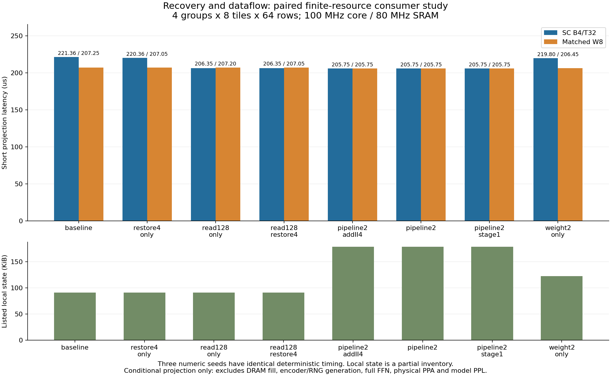

# 恢复吞吐与数据流消费实验（Issue124）

本模块复用 Issue116 的周期内核、PR120 的 SRAM→权重保持合同、PR122 的逐输出恢复数值与资源参数，检查它们在有限资源下的短投影消费行为。完整 FFN 接合与 STA/PPA 由 Issue123 继续；本轮不修改其代码或接管任务。

执行源码冻结于 `54a9968`；主网格为4组64输入、8个64输出tile、B4/T32/K32、三seed，共8配置×3seed×SC/W8=48项。输入是合成 FP32/W8 与冻结分层门限，不是模型推理。每项分别执行 cycle/event，保存原始轨迹和逐输出原字；源、输入、依赖及压缩/解压后成果都有SHA。

## 资源合同与证据边界

- 核心100MHz、SRAM80MHz；PR120供数轨迹从50ns共同边沿开始。每组权重占独立地址，部分和位于其后，4组权重加部分和共133120B，未超过1MiB SRAM。初始权重已在片上；DRAM装填不在范围内。
- 每个SC输出有96B位平面计数和16B显式元数据。局部读口16B或128B，读取需要实际服务周期；整包复制到有界暂存后才可释放计数槽。增加读宽代表新增物理接口能力，不能当作免费参数。
- PR122默认恢复延迟2周期、II=1，配置1或4个完整B4恢复lane；每lane结果槽4个，跨组FP32加法独立计时。全部周期是条件接口参数，不是目标工艺STA证明，也不是旧72-op恢复代理的简单相减。
- 权重保持、计数波、暂存、恢复输出和待写结果均有独立容量/寿命。输出信用保留到加法完成；写信用保留到回写完成。按group/row记录身份，不只核对token数量。
- 部分和为4B逻辑值、16B物理带掩码事务；保持同beat其他字节，按前组同row写→后组读的顺序回放。默认服务为12.5ns SRAM +20ns CDC +1ns fabric，取整为37.5ns，并在整个服务期占用排他fabric。读写采用相同保守服务；写时序是本模块假设，不是PR120原生写端验证。kernel不允许同边沿信用转发，还会产生显式边沿间隙。
- W8使用同一输入、权重、scale、地址、存储配置、缓冲和读宽。算术参考为按输入顺序的FP32乘法再加法（非FMA）、块scale和跨组归约；生产吞吐按512 MAC/周期条件模型，保留每输出64步顺序依赖。它不是已综合数字阵列；两方法也不是相同总面积或相同输出质量。
- 局部状态清单不包括未知的恢复流水内部、控制、互连、编码和随机源位数；两方法保留相同最大计数分配，W8未用的空间没有免费返还。完整面积、能量与PPL均为null。

## 结果入口

48项均完成，cycle/event原生轨迹、回调可观测量和逐输出参考一致。独立验证器核对完整网格、输入与13份依赖、资源容量/II、credits、动作守恒、逐笔SRAM掩码及最终字节；另15类篡改被拒绝。三seed的时延相同，因为调度不依赖采样数值；seed用于数值和身份覆盖，不构成性能置信区间。

| 配置 | SC (µs) | W8 (µs) | SC降幅 | W8降幅 | SC/W8 | 已列局部状态 (KiB) |
|---|---:|---:|---:|---:|---:|---:|
| baseline | 221.363 | 207.250 | 0.00% | 0.00% | 1.0681 | 90.891 |
| restore4_only | 220.363 | 207.050 | 0.45% | 0.10% | 1.0643 | 91.172 |
| read128_only | 206.350 | 207.200 | 6.78% | 0.02% | 0.9959 | 90.891 |
| read128_restore4 | 206.350 | 207.050 | 6.78% | 0.10% | 0.9966 | 91.172 |
| pipeline2_addII4 | 205.750 | 205.750 | 7.05% | 0.72% | 1.0000 | 179.172 |
| pipeline2 | 205.750 | 205.750 | 7.05% | 0.72% | 1.0000 | 179.172 |
| pipeline2_stage1 | 205.750 | 205.750 | 7.05% | 0.72% | 1.0000 | 178.844 |
| weight2_only | 219.800 | 206.450 | 0.71% | 0.39% | 1.0647 | 122.891 |

这里的降幅均相对于该方法自己的baseline。只增加恢复lane，SC降幅约0.45%；将局部计数读口16B改为128B，SC降至206.35µs（约6.78%）。双槽配置pipeline2为205.75µs，相对SC baseline降低约7.05%，但同配置W8也是205.75µs，不能据此宣称SC胜过W8。它需要额外的权重/计数保持和输出槽，不能称相同总面积。单暂存槽pipeline2_stage1保留在表中，显示本次低频下游服务条件下并不需要4个暂存槽。

宽读口使SC计数读取服务从143.36µs降至20.48µs，仍有3584笔部分和事务×37.5ns=134.4µs，以及26.4µs供数共用排他接口。pipeline2的160.8µs服务与44.95µs边沿/信用间隙正好覆盖205.75µs。各资源服务时间可能重叠，不能相加为总时延；此值也不是架构无关下界。加法II=4的对照未改变总时延，表明这次扰动未使加法成为限制；不能将其写成已验证的加法受限点。

加宽读口没有减少流量：SC局部物理读取从229376B增至262144B，W8从65536B增至262144B。部分和读/写物理字节固定24576/32768B，逻辑字节6144/8192B；权重预取均131072B。因此下一步应研究4行部分和合并访问、读写缓冲或有合法端口支撑的重叠，并向W8开放相同改进。组合等待、额外队列与物理实现必须重新计入，不能先把4倍字节利用率换成4倍速度。



局部SC/W8数值差异随seed记录于 [SUMMARY.json](results/analysis/SUMMARY.json)，不是模型PPL或用户质量验收。验收见 [VALIDATION.json](results/analysis/VALIDATION.json)；逐项表见 [CASES.csv](results/analysis/CASES.csv)。原始压缩轨迹在results/shard0..3；receipt同时绑定压缩和解压后原字节。完整清单见 [ARTIFACT_MANIFEST.json](ARTIFACT_MANIFEST.json)。

## 复现与交接

依赖源固定在 `dependencies.py`，13份精确Git原字节已核，详见 `work/amlink1219/124/DEPENDENCIES.json`。PR120/122均为待审依赖。本轮使用的Issue116提交 `6a56940900cf7e104f1c6c10ca8698c739e1da52` 初次冻结时未公开，GitHub提交接口HTTP422；在它公开前，新机器不能仅凭GitHub重建依赖。已有本机缓存及Git对象可复现；不将此限制隐去或改用未审核的最新代码。

```sh
python -m architecture_tlm.ffn_dataflow_optimization.dependencies --repository . --output /owned/new/dependency_cache
python -m architecture_tlm.ffn_dataflow_optimization.run prepare --dependencies /owned/new/dependency_cache --output /owned/new/fixtures --groups 4 --tiles 8 --seeds 0 1 2
python -m architecture_tlm.ffn_dataflow_optimization.run run --dependencies /owned/new/dependency_cache --fixtures /owned/new/fixtures --output /owned/new/run --groups 4 --tiles 8 --seeds 0 1 2 --candidates all --mode both --max-cases 48
```

必须从冻结执行提交运行；输出路径必须全新。完整验收命令和发布状态见 `work/amlink1219/124/HANDOFF.md`，不自动合并待审PR。
