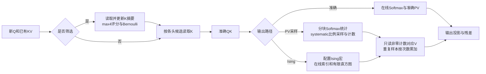

# LLaMA-1 7B：独立完整模型 TLM

任务 [Issue #12](https://github.com/rayggxia-workspace/pbit-llm-qwen-baselines/issues/12)，负责人 @jieruiz。正式代码、配置、验证和结果均放在本目录；不覆盖 Qwen 和早期 LLaMA 实验。结果入口为 [完整中文总表](results/current/RESULTS_ZH.md)，模型原始轨迹和完整事务日志按成果索引保存在已授权服务器。

这次把当前 Qwen 的优化迁入 LLaMA，并补上两者的实际结构差异。这里的准确 BF16 基线是**同一 ASIC 资源假设下的 TLM 基线**，不是 RTX 5090 的性能或功耗。真实 GPU 只用于生成核验过的 QK 轨迹。

## 主表比较哪些方案

| 名称 | FFN | Attention 核心 |
|---|---|---|
| `bf16_dense` | BF16 数字矩阵、SiLU 和逐元素乘法 | 完整 QK、Softmax、PV |
| `int8_dense` | 固定 W8 数字矩阵、连续接口与 SiLU | 完整 QK、Softmax、PV；用于区分量化和随机计算收益 |
| `sc_dense` | 固定 W8、A8 随机输入、并行精确计数 | 完整准确 Attention |
| `sc_pv` | 同上 | 完整准确 QK/Softmax，按比例 PV 采样 |
| `sc_screen_exact` | 同上 | max4 选块，候选内准确 QK/Softmax/PV |
| `sc_screen_pv` | 同上 | max4 选块，准确 Softmax，按比例 PV 采样 |
| `sc_ising` | 同上 | 完整 QK，Ising 宏输出索引并选择累加 V |
| `sc_screen_ising` | 同上 | max4 选块，候选 QK，Ising 宏及 V 选择累加 |

所有方案都包含32层、Q/K/V/O投影、归一化、残差、FFN、独立输入嵌入和最终词表读出。输出使用分块 greedy argmax，不为推理添加词表 Softmax。仿真边界从已有 prefill/KV 开始，包含一个 decode token；不包含 prefill、主机和芯片 PHY/CTS。

## 模型和硬件配置

| 项目 | 本次配置 |
|---|---|
| 模型 | `huggyllama/llama-7b` 转换的 LLaMA-1 7B；配置/权重分片/分词器 SHA 在捕获记录中重新核验 |
| 模型尺寸 | 32层、hidden4096、FFN11008、32Q/32KV、head128、vocab32000；6,738,415,616参数 |
| 独立结构差异 | embedding与lm_head不共享；显式读取每层两组RMSNorm及final norm权重；没有QKV偏置 |
| 上下文 | 原生512/1024/2048；每次精确prefill L-1个token后单步decode，总长度L，无8K外推 |
| FFN 随机计算 | 100MHz；默认8个64×64阵列；T4096；gate/up合并；数字SiLU(g)×u；down随机矩阵；BF16残差接口 |
| FFN 随机源 | 本地32位PRNG状态与检查点、8位阈值字供64路比较；输出波次重放；分层根熵及子种子计费；不存4096拍随机流 |
| 权重驻留 | 固定W8从DRAM分块加载到SRAM，双缓冲及resident宏接口；没有每权重有效位；resident供给电路仍为宏级参数 |
| Attention随机源 | PV每头一个systematic phase；筛选按需本地随机字；分层根种子计费。Ising内部随机源、状态和读出包含在宏PPA中 |
| PV预算 | S=L/16，512→32、1024→64、2048→128；本次长度无取整歧义；按原上下文而非候选长度定预算 |
| 片上SRAM | 统一8MiB、16条128bit lane、SS角80MHz、16GB/s输出fabric；按校准4096×128宏组成，容量不会免费增加带宽 |
| SRAM调度 | 投影/FFN为128KiB保留区＋两个权重槽；Attention阶段复用全部bank；容量检查、端口冲突、字粒度访问、CDC及读写能耗保留 |
| DRAM | 2通道×2rank×8颗4Gbit x8 DDR4＝16GiB；64B访问、32在途burst、实际地址、FR-FCFS调度；Staggered主表、NoPowerDown对照 |
| DRAM能耗 | DRAMSys5.6.0/DRAMPower6.3.1；采用已核查Micron电流情景，独立报告core和未校准interface代理 |
| 数字算子 | 512 MAC/cycle、64 vector op/cycle、16 nonlinear op/cycle；能量和面积多数仍为可调系数 |

8MiB是保守可运行配置，不是已完成的面积最优搜索。额外16/32/64随机阵列只作吞吐/面积敏感性；64阵列增大一次权重槽以容纳完整波次，超过配置面积预算的行明确标记。

## Attention 的具体数据流



MHA中每头拥有独立K/V，所以候选K比例和有效K读取比例应相等。256B的head向量对齐到4个64B burst；筛选不会因另一查询头的候选而扩大本头读取。真正物理流量仍包括摘要、更新、描述符和DRAM命令，不能只看QK保留率。

PV使用一个全局systematic phase形成严格S个样本，按块prefix和局部计数生成读取列表；不对每个样本做一次独立CDF二分搜索。零预算块也先读取预算；Ising则扫描直方图后才跳过零输出块。重复V只读一次，重复样本的加法仍收费。

筛选采用max4固定bias/temperature，**没有借用Qwen的24×14校准，也不是早期LLaMA的块均值筛选器**。摘要在prefill构建的成本在测量边界之前；每次decode（包括第一次）更新最新K摘要并读取摘要，不免费略去新增K。

Ising是一个足额配置、串行服务各头的宏接口，默认capacity=L；筛选后未自动缩小宏面积，避免将可变候选错误当作总能容纳固定小维度。内部混合、反馈和器件没有新电路验证，默认IID oracle仅决定工作负载地址。宏输出直接驱动V列表，不再进行第二次PV采样。

## 真实轨迹与数值结论的边界

Slurm1877采集三个上下文，各32层×32头。原模型、tokenizer和WT2字节SHA均重新核验；每个上下文先运行原样BF16参考，再运行只加观察钩子的前向。两次输出逐位相同，greedy也一致。捕获来自真实post-RoPE Q与cache K的FP32点积，未对BF16 Softmax反取log。

这些轨迹来自一个固定公开WT2窗口、每个上下文一条decode query。随机路径三种子只改变筛选/采样地址，不代表更多文本样本。TLM用相同BF16轨迹对比各硬件路径，**没有重新执行随机FFN后的联合数值推理，也没有新PPL**。离线保留attention mass只是筛选诊断，不能代替PPL。旧LLaMA的A12/固定512样本/CTMC结果不能为本次A8共享、比例PV和Ising宏背书。

## 运行与复现

```sh
python architecture_tlm/llama7b/test_model_contract.py
python architecture_tlm/llama7b/tests/test_attention_adapter.py
python architecture_tlm/llama7b/dram/test_dram_config.py
python architecture_tlm/llama7b/run.py --case sc_screen_pv --context 2048 \
  --seed 0 --trace /path/to/c2048.trace.json --output NEW_RESULT.json
python architecture_tlm/llama7b/run.py --case sc_screen_pv --context 2048 \
  --seed 0 --trace /path/to/c2048.trace.json --output NEW_DRAM_RESULT.json \
  --bridge /path/to/pbit_dram_bridge_sg_v6_audit \
  --dram-config architecture_tlm/llama7b/dram/configs/ddr4_2ch_2rank_Staggered_core_limits.json
```

运行入口拒绝覆盖结果，超原生上下文、SRAM不足、候选超过Ising容量都会报错。源快照逐文件SHA由 `verify_snapshot.py` 在每个Slurm任务前核对；任务开始后不修改快照。捕获、Link、DRAMSys以及后处理版本分别记录，不把后处理提交伪装成原仿真提交。

`runtime/SOURCE_SNAPSHOT.json` 记录从最新本地Qwen引擎导入时的源字节与规范化字节；此后LLaMA的必要修改由Git历史和 `EXECUTION_MANIFEST.json` 记录。它们不表示所有旧源码仍然逐字未改。`dram/` 保存独立配置、桥、来源及跨rank微事务验证；工艺库、权重和长轨迹不上传Git。

## 尚未具备的硬件证据

SRAM成本有现有工艺/校准支撑；随机核沿用既有RTL/PT活动情景的复制代理。实际W8存储格式与旧RTL的额外符号位、resident SRAM到并行阵列的接口、A8前端电路、数字非线性、PRNG/互连和Ising宏仍需要进一步PPA。面积不含完整布线、CTS、PHY和芯片外DRAM。DRAM接口系数、器件典型功耗和多rank板级时序也未认证。

因此主表用于寻找瓶颈与比较架构情景，不能称作流片能耗、GPU能效倍率或质量已经相同的最终设计。
