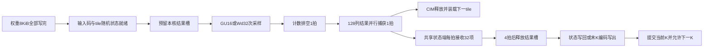

# 五核TLM与RTL接口合同

日期：2026-11-25；Issue225 / PR266。配套可执行参数为 `ALIGNMENT_CONTRACT.json`，小形状轨迹由 `run.py --scope small --trace` 产生。本合同沿用五核动态派发、私有8KiB单权重区和共享跨K状态，不固定输出组所属核。

**同日用户追加选择：** 当前合同采用21bit计数/结果槽、本地PRNG持续供数，详见 `COUNTER21_LOCAL_RNG_ZH_20261125.md`。下文第2、5节为前一轮19bit/逻辑tile复现方案的历史解释；21bit新PPA未标定，固定步长或任意跳步均不是默认硬件要求。输入尺度遗漏仍需另补，80B仅含64×10bit码，不含共享恢复指数。

## 1. 结果先捕获，再释放CIM

|服务|输入/启动条件|启动间隔与延迟|输出及成本归属|
|---|---|---|---|
|每核CIM写入|本核单权重区空闲；共享DMA已返回数据|16bank各16B/拍，完整8KiB最低32拍；实际由返回和端口仲裁决定|所有目标写入完成才 `weight_ready`；按实际SRAM写动作计费|
|GU计算|权重、输入码、随机状态就绪，输出状态依赖允许，有结果槽|16采样＋1排空＋1捕获＝18拍/72ns|128路本地结果；现有完整FFN核价格|
|Wd计算|条件同上|32采样＋1排空＋1捕获＝34拍/136ns|同上；非线性和本地随机生成已在核内|
|结果槽|每核两槽；启动计算时预留|默认128列并行捕获；FIFO接收后CIM即可重用|不是跨K宽状态；已在 `sh_ab_result_fifo` 中计面积与能量|
|跨K状态|已捕获的结果、对应输出组owner；非首K先读1024B|两个独立worker，每worker32项/拍，II1、延迟1，共4次传输|局部值符号扩展为32bit接口，更新128×64bit状态；四拍就是原state32服务，不另加四拍|
|结果槽释放|最后一次32项传输已接收|默认最后一拍结束返还槽；不等后续状态写完|允许本核其他输出组继续；同一输出组仍等state_commit|
|GU末K编码|先得到完整跨K结果；共享1KiB暂存可用|scale64两组共6拍＋16lane codec共9拍＝15拍，外部读写另计|写128B g/u码和1B共享尺度；已有scale/codec/staging价格|
|Wd末K输出|同上|BF16 codec9拍，外部写入另计|写128×BF16＝256B；已有codec/staging价格|

状态worker保持“读→更新→写”的独立串行服务，不暗加同一worker的包级预读。两个worker、计算核和DMA可以并行。日志中的各核等待时间可相加超过墙钟时间，不能再把它们加到总时延上。

## 2. 位宽和实体容量

本价格所绑定的 `shared19.sv` 每槽存 **128×19bit＋33bit元数据**。五核两槽共24,650bit，其中净结果3,040B、元数据41.25B；位数是逻辑净值，不额外向SRAM容量取整。输出20bit线是符号扩展，当前单核功能原型21bit线可用同样方式扩展至32bit传输，跨K状态保持64bit。

默认W8幅值≤127、K64、最大T32时，绝对局部结果上界为260,096，小于19位有符号上限262,143。这个核价格和合同不自动扩展到T128；更长采样需重新检查计数位宽与价格。新增结果槽、缓存的面积均为0，是因为已包含在现有核价格中，不是硬件免费。

每核输入缓存沿用640bit GU码、1024bit Wd码、7bit尺度、6/8bit标签和2个valid，共1,687bit；五核8,435bit。它不占用独立普通operand FIFO。缓存生命周期key为 `(command, layer, mode, k)`，开始新阶段或命令失效。

## 3. 数据布局与物理事务

以下offset相对既有 `self.vector` 区域；W为 `ffn/64`，H为 `hidden/64`，Qwen3-4B为W152/H40。

|记录|逻辑位置与宽度|实际SRAM动作|
|---|---|---|
|GU输入x码及输入元数据|`80*k`，80B|未命中读5个16B字；命中不读|
|Wd输入g/u码|`8192+128*k`，128B|未命中读8字|
|Wd输入共享尺度|`65536+cross_gu_scale+k`，1B|未命中另外读1个16B字|
|GU权重尺度对|`65536+2*(out*H+k)`，2B|每tile读1个16B字；没有隐含尺度缓存|
|Wd两个权重尺度|`65536+2*W*H+(2*out+plane)*W+k`，各1B|当前为两次独立16B访问；没有假定自动合并|
|跨K状态|`1024*state_slot(out)`，1024B|非首K读64字；非末K写64字|
|GU末K输出|`8192+128*out`，128B；尺度另1B|分别8字、1字写入|
|Wd末K输出|`256*out`，256B|16字写入|

真正取整由父BeatSRAM完成；trace只记录并核对其16B动作，不再重复发事务或加能量。K顺序由 `expected[out]`、`occupied` 和状态槽owner保证，结果槽和状态槽是两个不同生命周期。

## 4. 五核共享DMA

沿用全局16KiB返回保持，不复制成五份。每个64B返回包先预留容量；待四次16B目标写全部完成才返还该槽/信用。容量条件为 `64*pending + returned_not_landed <= 16384`。目标路由由CIM_core编号和tile偏移确定，bank=`offset//16%16`，row=`offset//256`，没有整块普通SRAM中转或513拍寄存器复制。

元数据采用现有4KiB control预算：256×64bit在途包头＝2KiB，64×32B描述符＝2KiB。包头/描述符是容量合同，尚不是综合后控制器布局。当前64描述符设有硬上限检查；16KiB载荷和256请求信用由父模型实行真实回压。若未来工作负载超过64个活跃描述符，模型拒绝该运行，需补生产端等待，不能让队列无界增长。

单核目标阻塞压力用例会延迟该核实际目标写入，期间载荷继续占用同一16KiB槽；不凭空换一个无限缓冲。其他核的合法返回仍可写入。

## 5. 随机状态接口

逻辑tile身份为 `(command,layer,mode,out_group,k)`。每次FFN命令由调用方提供独立基准状态。GU使用一条、Wd使用三条32bit状态流；规范顺序为输出组优先、组内K递增，起始步数为 `(out_group*Kblocks+k)*T`。与核编号及完成先后无关。

`rng_reference.py` / `RNG_TRANSITION.json` 从现有GF64 RTL异或网络提取线性转移，并用GF(2)跳步核对顺序流分配；**这是软件数值参考，不是新增跳步电路**。TLM只运行有延迟的状态提供接口：默认延迟1拍、II1，与权重加载重叠，可用 `--rng-assignment-latency` 做敏感性分析。

默认控制成本暂归已有条件化platform控制/分发宏，不额外重收FFN本地PRNG和比较器费用。RTL仍需选择可实现的状态提供方案，并补其PPA差额；完整随机样本无需在系统TLM内逐位重放。

## 6. RTL下一步只需对齐这些接口

1. 按五核共享调度实现跨核输出组顺序；不要恢复固定输出→核绑定。
2. 对齐上述输入缓存布局、128列捕获、每核双结果槽和32项/拍状态端口。
3. 接共享16KiB DMA，返回信用在目标落地后释放，不能每核各复制一份。
4. 选择逻辑tile状态分配的真实实现；使用同一tile身份核对数值，不以物理核种子代替。
5. 导出同名关键事件，与小形状trace比较工作量、依赖和占用。当前通过的是TLM内部资源验证，不是五核RTL逐周期等价验收。
