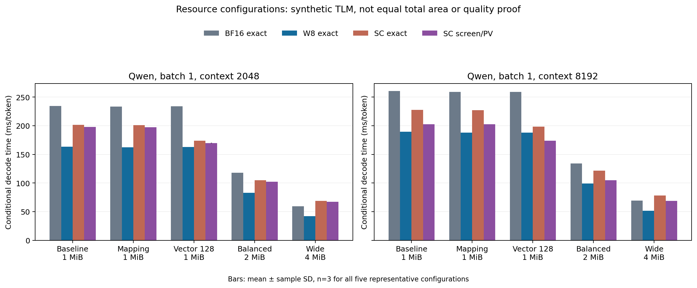
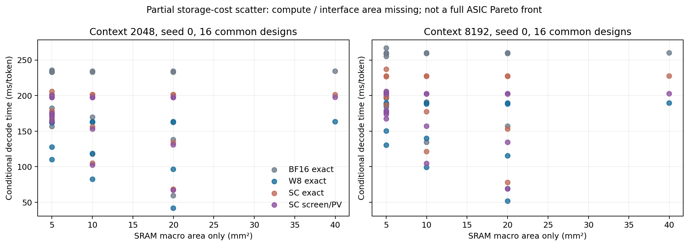
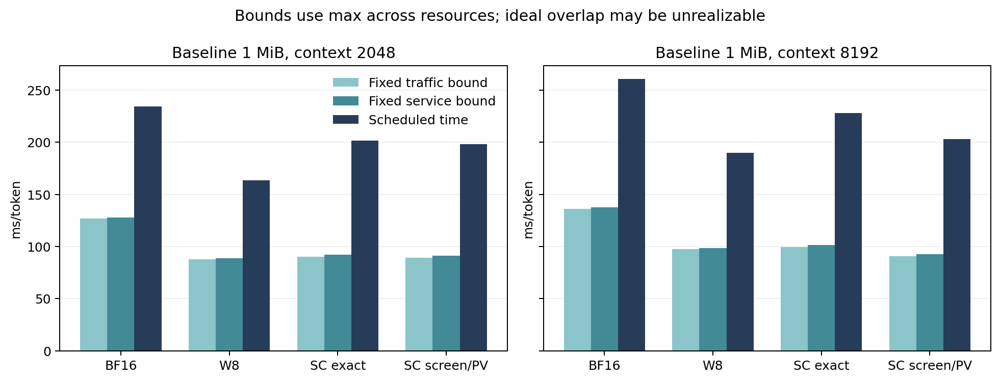

# ASIC资源优化首轮结果（Issue117）

**128项共同候选粗筛＋64项预声明代表点补充＋16项vector128跟进，共208项新完整decode TLM执行。** 五个代表点每种方法/上下文均有seed0/1/2；另外11候选只做seed0粗筛。全部是合成路由事务估计，不是GPU速度、模型质量或物理芯片测试。

主要结果：当前映射下只扩2/4/8MiB容量没有时延收益；同1MiB重新分块只有小幅收益。向量恢复资源加倍后，SC筛选/PV在8K出现相对同配置W8的条件时延收益，2K没有。继续扩带宽/算术时数字W8也显著受益，不能宣布SC普遍更优。完整面积/能量/A0仍null，暂不建立完整同面积Pareto排名。

## 当前项目与执行版本

- 开始时实时核验集成`46804fb3a1c50b29a19a7d0a3da6bb8f8b59af7d`。PR103/105/106/108/109/111/113/114均已合并，不能沿用原计划中的“待合并”状态。Issue116独立推进周期级执行后端，本任务不修改其实现。
- 发布期间新增[PR120](https://github.com/rayggxia-workspace/pbit-llm-qwen-baselines/pull/120)（Issue118），提供独立FFN供数合同和逐档整数状态模型，尚未合并，也未纳入本轮执行；不可把本轮旧v6的局部状态缺项表理解为该并行任务没有工作。后续优先对接其已提供接口，与Issue116协作验证。
- 粗筛执行`44dbbbdbc2720963b2b24bf03cdf7582a2d97075`；首批补充执行`315862412e15695c3fa21e6c573d9e5f3547e70d`；vector128跟进执行`b1b4d18`。十份执行清单的数值/调度源SHA集合相同；提交差异仅P0文档/结果或后处理工具。运行时源码、配置和各case原字节均绑定。
- Qwen2.5-0.5B，24层、batch1、2K/8K、单decode token；固定W8/B4/T32/K32，PV预算L/16，真实有限随机服务。100MHz核心/源，80MHz SRAM；只改变白名单中的资源和分块字段。
- 所有52旧＋40已集成随机服务原件保持不变；145payload SHA审计通过。没有新模型/分词器/语料推理、PPL、GPU/Slurm、RTL/EDA/STA或真实DRAMSys运行。

## 三seed代表点（ms/token，均值±样本标准差）

### 上下文2048

| 配置 | BF16准确 | W8数字准确 | SC准确 | SC筛选/PV |
|---|---:|---:|---:|---:|
| baseline_1m | 234.36001 ± 0.00000 | 163.56481 ± 0.00000 | 201.72241 ± 0.00000 | 198.01068 ± 0.02455 |
| mapped_1m | 233.17317 ± 0.00000 | 162.37677 ± 0.00000 | 201.22317 ± 0.00000 | 197.58449 ± 0.02477 |
| vector_128 | 233.93483 ± 0.00000 | 163.13726 ± 0.00000 | 173.67562 ± 0.00000 | 169.93475 ± 0.02466 |
| balanced_2m | 117.98820 ± 0.00000 | 82.71900 ± 0.00000 | 105.07622 ± 0.00000 | 102.39647 ± 0.01198 |
| wide_4m | 59.62388 ± 0.00000 | 41.98989 ± 0.00000 | 68.58069 ± 0.00000 | 67.15782 ± 0.00579 |

### 上下文8192

| 配置 | BF16准确 | W8数字准确 | SC准确 | SC筛选/PV |
|---|---:|---:|---:|---:|
| baseline_1m | 260.45281 ± 0.00000 | 189.65761 ± 0.00000 | 227.81521 ± 0.00000 | 202.81496 ± 0.01960 |
| mapped_1m | 258.96357 ± 0.00000 | 188.16717 ± 0.00000 | 227.01357 ± 0.00000 | 202.38262 ± 0.01897 |
| vector_128 | 258.89483 ± 0.00000 | 188.09726 ± 0.00000 | 198.63562 ± 0.00000 | 173.90749 ± 0.01920 |
| balanced_2m | 134.38500 ± 0.00000 | 99.11580 ± 0.00000 | 121.47302 ± 0.00000 | 104.90862 ± 0.00928 |
| wide_4m | 69.18548 ± 0.00000 | 51.55149 ± 0.00000 | 78.14229 ± 0.00000 | 68.98804 ± 0.00465 |

`mapped_1m`保留原1MiB/16bank/fabric16GB/s、DRAM16GB/s/窗口32、512MAC/64vector/8SC，只增加权重slot到256KiB并将Attention tile改256。`balanced_2m`为2MiB/32bank/fabric32、DRAM32/窗口64、512MAC/128vector/8SC。`wide_4m`为4MiB/64bank/fabric64、DRAM64/窗口128、1024MAC/128vector/16SC；后两者的新增接口/算术成本尚未物理标定。

## 具体收益与负结果

| 上下文/方法 | 同1MiB映射时间下降 | 2MiB联合时间下降 | 4MiB高资源时间下降 |
|---|---:|---:|---:|
| 2048 / BF16准确 | 0.506% | 49.655% | 74.559% |
| 2048 / W8数字准确 | 0.726% | 49.427% | 74.328% |
| 2048 / SC准确 | 0.247% | 47.910% | 66.002% |
| 2048 / SC筛选/PV | 0.215% | 48.287% | 66.084% |
| 8192 / BF16准确 | 0.572% | 48.403% | 73.436% |
| 8192 / W8数字准确 | 0.786% | 47.740% | 72.819% |
| 8192 / SC准确 | 0.352% | 46.679% | 65.699% |
| 8192 / SC筛选/PV | 0.213% | 48.274% | 65.985% |

1. **容量only 24组配对全部无收益。** 2/4/8MiB保持旧分配时，四方法×两上下文的时间、物理流量、Arena布局及全部候选/采样地址摘要与1MiB相同；只有宏数量、面积和泄漏增加。它不证明新KV缓存/驻留策略也无收益。
2. **1MiB还有可用映射空间。** mapped_1m在8K筛选PV下Arena峰值979,136B，低于1,048,576B；没有新增跨token权重驻留，SC波次不随普通权重chunk扩大而自动变化。
3. **vector128确认共享向量资源的敏感性。** B4/T32计数恢复353,009,664个代理op，64/128lane服务分别55.15776/27.57888ms。恢复服务减少27.57888ms，整机还受其他向量阶段和调度影响，不能只按恢复服务从墙钟相减。这不是专用恢复RTL或已通过STA的吞吐。
4. **DRAM候选联合改变带宽和在途窗口。** 16/32/64GB/s与窗口32/64/128对应原Link满窗口持续率9.846/19.692/39.385GB/s。收益不能归因于带宽单项，更不证明控制器/PHY已实现。
5. **数字对照必须共同优化。** vector128在8K的正向结果触发了另外两seed的明确跟进，未更改算法或预算；它不是盲测质量结果。下面列出同配置SC筛选/PV相对W8数字的时间比；大于1表示SC较慢。

| 配置 | 2K SC筛选/PV ÷ W8 | 8K SC筛选/PV ÷ W8 |
|---|---:|---:|
| baseline_1m | 1.2106 | 1.0694 |
| mapped_1m | 1.2168 | 1.0755 |
| vector_128 | 1.0417 | 0.9246 |
| balanced_2m | 1.2379 | 1.0584 |
| wide_4m | 1.5994 | 1.3382 |

## 随机路径与质量边界

逐query记录全部候选绝对token ID和全部抽样绝对token ID摘要；样本行覆盖24×14=336，每行输出2K128/8K512。每个新资源配置均与相同seed基线比较；源总摘要还包含FFN重放，不能仅因总摘要变化就断言Attention样本变化。

| 相对相同seed基线（所有非基线case） | 相同 | 不同 |
|---|---:|---:|
| 候选token序列 | 184 | 0 |
| 抽样token序列 | 184 | 0 |
| 所有源输出记录 | 164 | 20 |

地址相同只证明本次合成事务可配对，不证明完整LLM质量。改变分块可能改变真实有限精度在线Softmax的结合顺序；TLM没有执行这些张量运算。用户尚未指定可接受PPL损失，不能以任意质量阈值完成架构验收。

## 全部16候选（seed0）

| 候选 | 容量/组织与覆盖参数 |
|---|---|
| baseline_1m | `{}` |
| capacity_2m | `{"sram.capacity_bytes": 2097152}` |
| capacity_4m | `{"sram.capacity_bytes": 4194304}` |
| capacity_8m | `{"sram.capacity_bytes": 8388608}` |
| mapped_1m | `{"attention.tile_tokens": 256, "weight_chunk_bytes": 262144}` |
| buffer_2m | `{"sram.capacity_bytes": 2097152, "weight_chunk_bytes": 262144}` |
| buffer_4m | `{"sram.capacity_bytes": 4194304, "weight_chunk_bytes": 524288}` |
| fabric_32 | `{"sram.banks": 32, "sram.capacity_bytes": 2097152, "sram.fabric_GBs": 32.0, "weight_chunk_bytes": 262144}` |
| fabric_64 | `{"sram.banks": 64, "sram.capacity_bytes": 4194304, "sram.fabric_GBs": 64.0, "weight_chunk_bytes": 524288}` |
| dram_32 | `{"dram.bandwidth_GBs": 32.0, "dram.max_pending": 64}` |
| dram_64 | `{"dram.bandwidth_GBs": 64.0, "dram.max_pending": 128}` |
| compute_small | `{"ffn.engines": 4, "macs_per_cycle": 256}` |
| compute_large | `{"ffn.engines": 16, "macs_per_cycle": 1024, "vector_lanes": 128}` |
| vector_128 | `{"vector_lanes": 128}` |
| balanced_2m | `{"dram.bandwidth_GBs": 32.0, "dram.max_pending": 64, "sram.banks": 32, "sram.capacity_bytes": 2097152, "sram.fabric_GBs": 32.0, "vector_lanes": 128, "weight_chunk_bytes": 262144}` |
| wide_4m | `{"dram.bandwidth_GBs": 64.0, "dram.max_pending": 128, "ffn.engines": 16, "macs_per_cycle": 1024, "sram.banks": 64, "sram.capacity_bytes": 4194304, "sram.fabric_GBs": 64.0, "vector_lanes": 128, "weight_chunk_bytes": 524288}` |

### 上下文2048粗筛时间，ms/token

| 候选 | BF16准确 | W8数字准确 | SC准确 | SC筛选/PV |
|---|---:|---:|---:|---:|
| baseline_1m | 234.36001 | 163.56481 | 201.72241 | 198.00316 |
| capacity_2m | 234.36001 | 163.56481 | 201.72241 | 198.00316 |
| capacity_4m | 234.36001 | 163.56481 | 201.72241 | 198.00316 |
| capacity_8m | 234.36001 | 163.56481 | 201.72241 | 198.00316 |
| mapped_1m | 233.17317 | 162.37677 | 201.22317 | 197.57742 |
| buffer_2m | 233.27397 | 162.47637 | 201.32397 | 197.60532 |
| buffer_4m | 233.31467 | 162.49787 | 201.38147 | 197.66252 |
| fabric_32 | 169.90363 | 118.65104 | 156.34306 | 153.16386 |
| fabric_64 | 138.25948 | 96.77068 | 134.02944 | 131.13434 |
| dram_32 | 182.70803 | 127.94123 | 178.30523 | 175.10728 |
| dram_64 | 156.87908 | 110.08148 | 166.62433 | 163.68353 |
| compute_small | 236.11468 | 165.36749 | 206.01148 | 200.84208 |
| compute_large | 233.05512 | 162.24433 | 175.60513 | 172.58358 |
| vector_128 | 233.93483 | 163.13726 | 173.67562 | 169.92697 |
| balanced_2m | 117.98820 | 82.71900 | 105.07622 | 102.39187 |
| wide_4m | 59.62388 | 41.98989 | 68.58069 | 67.15489 |

### 上下文8192粗筛时间，ms/token

| 候选 | BF16准确 | W8数字准确 | SC准确 | SC筛选/PV |
|---|---:|---:|---:|---:|
| baseline_1m | 260.45281 | 189.65761 | 227.81521 | 202.83611 |
| capacity_2m | 260.45281 | 189.65761 | 227.81521 | 202.83611 |
| capacity_4m | 260.45281 | 189.65761 | 227.81521 | 202.83611 |
| capacity_8m | 260.45281 | 189.65761 | 227.81521 | 202.83611 |
| mapped_1m | 258.96357 | 188.16717 | 227.01357 | 202.40317 |
| buffer_2m | 259.36677 | 188.56917 | 227.41677 | 202.43877 |
| buffer_4m | 259.40747 | 188.59067 | 227.47427 | 202.49597 |
| fabric_32 | 191.27323 | 140.02064 | 177.71266 | 157.17861 |
| fabric_64 | 157.26748 | 115.77868 | 153.03744 | 134.74469 |
| dram_32 | 204.94163 | 150.17483 | 200.53883 | 179.27028 |
| dram_64 | 177.21188 | 130.41428 | 186.95713 | 167.51613 |
| compute_small | 267.36268 | 196.61549 | 237.25948 | 205.83388 |
| compute_large | 255.43272 | 184.62193 | 197.98273 | 176.50163 |
| vector_128 | 258.89483 | 188.09726 | 198.63562 | 173.92807 |
| balanced_2m | 134.38500 | 99.11580 | 121.47302 | 104.91867 |
| wide_4m | 69.18548 | 51.55149 | 78.14229 | 68.99319 |

这只是SRAM宏面积与时间散点。1/2/4/8MiB为4.994613/9.989226/19.978452/39.956904mm²宏面积，未含wrapper/CTS/互连等；同一横坐标仍可能有不同MAC/SC/向量/外存资源，不能读成完整芯片Pareto前沿。

## 下界、缺项与下一步优化

下界跨资源取max；固定busy含原保守资源占用，不能当作任意新架构的理论下界。每个新映射都用本case物理流量重算，详见SUMMARY.json各行lower_bounds及P0_RESULTS_ZH.md。

优先落实两项P1接口：专用恢复/计数归约的真实latency、II与有限出口，及SC权重并行供给/保持和局部计数物理归属。E4/8/16当前计数表示为24/48/96KiB，权重波次为16/32/64KiB；它们尚未计入Arena宏面积，不能把SC引擎扩展视作免费。替换代理后要删除旧恢复收费。

其次实现真实驻留/KV组缓存和有限队列，比较同带宽/同窗口的持续在途DRAM后端；允许数字和SC共同使用这些调度。2MiB作为带宽/组织折中候选、4MiB作为高资源参考，当前证据不支持“仅容量2/4MiB最优”。Issue116的新周期后端可消费本轮配置及缺项接口，后续仍需按其完成状态独立验收。

面积账本闭合后才建立数字A0及同总面积前沿；用少数代表点做SRAM外围/恢复RTL STA-PPA和真实DRAM trace校准。prefill/TTFT、batch4/8、Llama规模外推、新算法PPL均未在本轮实现，不能从本表直接外推。

## 验证与制品

- 71项单元/机制测试通过（28新增＋43原v6）；128配置容量/组织检查包含于机制测试，不包装成128个电路测试。
- 208case完整键集合、配置/执行源/receipt散列、336query覆盖、相位时长、资源与容量守恒、24容量对照及7个新基线锚点由verify.py独立核验。
- 每份EXECUTION.json记录Python/系统/命令、执行提交、源文件SHA；RUN_MANIFEST.json冻结候选和种子，case及receipt保存原结果字节。原件未覆盖，失败/中断不能按complete计数。
- [机器汇总](results/analysis_20261023/SUMMARY.json)、[独立验收](results/analysis_20261023/VALIDATION.json)、[P0账本](results/p0_20261023/RESOURCE_LEDGER.json)；任务辅助证据与独立审阅见work/amlink1219/117。
- 结果与代码先通过workspace任务分支/PR119交付，待审、未自动合并。Projects缺read:project，Issue/PR/STATUS已同步时不等于看板已同步。
