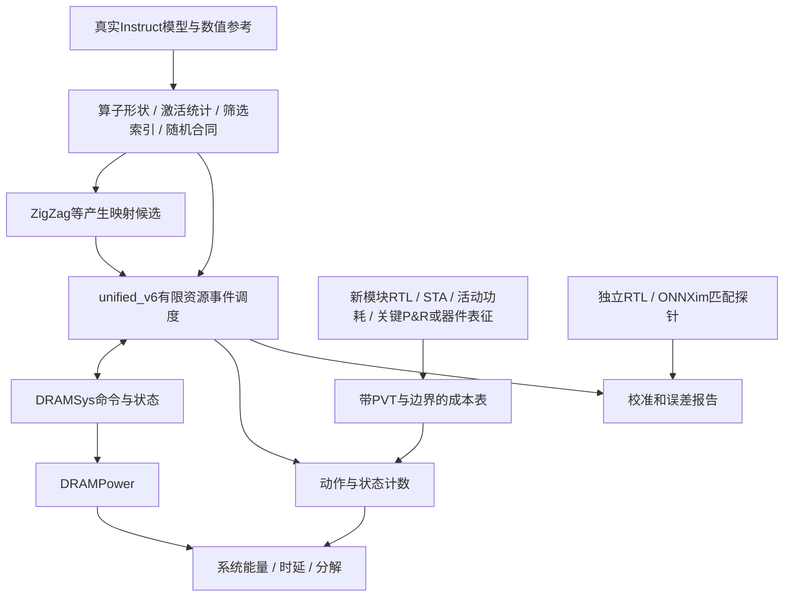

# p-bit LLM系统模拟器：需求、接口与验收建议

日期：2026-10-25。来源：[调研总报告](README_ZH.md)、[33条证据](EVIDENCE.md)。这是研究实施建议，不是本轮实现结果，不是会议统一强制标准，也不授权新的昂贵实验。

## 1. 先固定要证明的声明

我们的目标是独立p-bit/数字混合ASIC。若论文主张“优化LLM”，主结果至少要能从**同质量的完整推理路径**得到时延和能量，而不能仅把随机乘法的TOPS/W乘上操作总数。

建议分三层声明：

| 声明 | 最低对应证据 | 不能代替的东西 |
|---|---|---|
| 新模块更省面积/能量 | 相同功能/质量条件下的RTL或器件实现、技术成本、时序及活动 | 门数量、理想p-bit能量不能替代所有外围 |
| 架构提高吞吐/减少访存 | 有限资源和依赖的可执行模型、物理访存、独立短轨迹验证 | 只统计数学MAC/理想字节数 |
| 端到端LLM更有效率 | 数值模型与硬件工作量合同一致、完整路径、可比质量、内外存与控制成本 | 历史PPL+新形状时间拼接 |

目前PR183能支撑条件架构趋势/消融；完整能量和面积尚未闭合。Issue186负责继续共同调度实现。本文件定义后续应验证什么。

## 2. 推荐组合及其边界



图中双向DRAM接口意味着完成时间与回压真实返回调度器；不能事后独立跑一次DRAM，却仍用原来的固定带宽结果推进计算。成本表可采用Accelergy格式，不要求为了导入工具重写已经正确的账本。

选择ONNXim主要是独立对照，并非认定其调度全局最优。若研究贡献扩展到ISA、编译、算子融合，再评估PyTorchSim；若扩展多芯片/CXL或分离式服务，再评估ASTRA-sim。当前单ASIC无需同时接入所有工具。

## 3. 每个模块需要提供的合同

| 接口字段 | 至少记录 | 为什么 |
|---|---|---|
| 功能与数制 | 输入/输出shape、dtype、scale、舍入/饱和、累加位宽、随机编码 | 数值实验和硬件路径必须是同一个算法 |
| 随机流 | source ID、seed/状态、共享映射、更新/复用边界、相关性假设 | 共享流减少成本但可能改变联合分布 |
| 时间 | 时钟域、准备时间、服务延迟、启动间隔II、尾部flush | latency和吞吐不是同一个数 |
| 资源 | 并行lane/阵列数、端口、bank、队列深度、占用/释放时刻 | 防止免费并发或无限缓冲 |
| 数据 | 所有读写地址/大小、tile布局、burst拆分、对齐、padding、部分和 | 数学稀疏不能直接等于物理流量稀疏 |
| 反压 | 接收条件、credit、request/response、取消与重试语义 | 防止算子先完成后数据才到 |
| 成本 | 动作类别、每动作能量、漏电/idle/clock状态、面积、工艺/PVT和来源 | 避免算子之外遗漏或重复计费 |
| 证据 | RTL/电路/宏版本、配置SHA、验证范围、误差或未知项 | 预测值能被追溯 |

随机源需分别统计“生成多少新随机字/位”“向多少接收者分发”“同一随机样本重用几次”。不能把分发64路误算为生成64份独立随机数，也不能把共享导线、缓冲和比较器算成免费。

物理p-bit的翻转频率、有效独立采样率和同步读取频率不同。若输出有自相关，应测有效样本数或等价相关统计；不能把每一个时钟读取当成新独立样本。保留burn-in、拒绝/重试、有限样本计数和读出开销；在同质量预算下比较。

## 4. LLM路径完整性检查

| 路径 | 具体检查 |
|---|---|
| 输入与输出 | embedding、最终norm、lm_head、token选择/采样；说明哪些在host、是否计host通信 |
| Attention投影 | Q/K/V/O GEMM或GEMV、bias（模型有才计）、RoPE、GQA/MQA head映射 |
| KV cache | append、位置/层/head寻址、容量、精度、cache布局、padding、溢出、复用 |
| 筛选与采样 | 粗分数/阈值/归约、sigmoid、索引产生、去重或重复访问、gather、V累加及归一 |
| Softmax/Ising | max/scale或编译参数、耦合/全局反馈、演化、合法状态判定、概率/样本读出 |
| FFN | gate/up/down、分档编码、缩放系数、随机非线性、共享流重放、Wd直接输入、部分和与最终BF16 |
| 层间 | residual、RMSNorm/LayerNorm、格式转换、搬移/重排、同步和临时张量 |
| 系统 | DMA描述符、地址生成、SRAM仲裁、NoC/fabric、返回队列、CDC、控制、clock/idle |

这不是要求所有模块都做同样细的RTL。与贡献关系弱且成本小的模块可以采用有出处的宏模型，但要列出边界、保守或敏感性条件。不能因softmax不是GEMM就完全不计。

当前FFN的固定尺度、四档、T64/K64及新随机非线性必须与实际训练/评估路径保持一致；不能沿用旧“连续SiLU后z重编码”的时间或质量结论。当前GU恢复路径的数制与硬件候选还需核对，以最新设计文档为准。

## 5. TLM应该细到什么程度

**系统层可以事件驱动；决定瓶颈的资源需要准确的占用与完成事件。** 不必每个空闲核心周期都调用一次函数。DRAMSys本身就是TLM与周期约束兼容的实例。

一个tile的示意关系：

```text
ready = max(输入到齐, 权重/系数可用, 依赖完成, 资源可分配)
start = earliest_legal_time(ready, 端口/队列/时钟/仲裁)
finish = completion_from_service_model(start, 数据和随机配置)
后继只有在对应数据和response实际完成后才能消费
```

整个tile原子占用可以用于初始模型，但如果声称tile内部读、算、写重叠获得加速，就必须将这些阶段拆出并验证。反之，过度粗糙的“整波DMA完成屏障”会人为串行化，低估硬件；无限预取和免费双缓冲又会高估硬件。

多时钟域以整数时间单位或精确时钟换算管理。CDC FIFO必须有有限容量、跨域可见性延迟、credit及功耗。异步p-bit服务也用绝对时间返回完成/可采样事件，不能强行与核心周期一一对应。

## 6. 内存与DRAM的验收

必须能回答：

1. 逻辑tensor字节到SRAM事务、DRAM突发的转换在哪里发生？丢弃的K/V是否真的避免外部读？
2. 单通道/多通道、rank/bank/row映射是否与模型一致？随机地址是否改变行命中和突发利用率？
3. 共享SRAM读写是否争同一fabric？每个bank端口数是否真实？本地宽权重保持宏与普通SRAM成本是否分开？
4. 请求接收、队列占用、完成、消费是否形成正确因果链？运行结束是否drain全部在途事务？
5. DMA/compute重叠是否消耗真实的额外缓冲，而非只有时间轴重叠？
6. DRAM refresh、background、power-down、I/O开关活动是否计入？控制器与PHY在哪个成本边界？
7. 后端报告带宽、接口统计带宽与应用观察带宽是否能对账？

建议微基准包括连续读写、随机读、混合读写、同行/跨行、单bank/多bank、多个channel、不同outstanding、非整burst、强制回压、空闲刷新和尾部drain。对照不是只看平均带宽，还要比较延迟分布和资源等待。

PR183的负ACT分项不能简单清零；先核电流与状态公式的自洽性。该分项占比0.0934%不等于总能量误差。若只能获得datasheet上限，报告为模型估计及参数范围，不写芯片实测J/token。

## 7. 功耗/面积做到哪一步

针对新模块，建议最低包含：可运行RTL功能、目标工艺/PVT下综合、STA、代表性激励的活动功耗。采样数、稀疏度和共享随机源必须实际反映在活动中，不能统一假设50%翻转。

如果收益依赖高扇出随机广播、很宽SRAM输出、跨域接口、密集互连或极高时钟，关键模块优先做P&R与CTS后的分析；这些因素在综合阶段容易被低估。不是所有系统模块都要同时全芯片布局，但不能用逻辑面积声称完整芯片面积。

存储宏面积/功耗与外围控制应拆开；DC一般不会替我们从RTL寄存器数组自动得到所宣称的定制CIM宏。新器件须另给SPICE/实测/已发表模型来源，包含DAC/ADC、读写、驱动、补偿与状态保持，若不使用ADC也说明真实读出电路。

能量账本以模块证据级别标识：

- measured：该边界实际测量；
- post_layout：已布局后的估算；
- synthesis_activity：综合/网表活动；
- macro_model：已表征存储或其他宏；
- literature_projection：借值/缩放；
- assumption或unknown：假设/未知。

这些是数据标签，不是简单好坏排名。不同标签不能不加说明地合成“实测整机能量”。新数字仿真继续进入已有digital_circuit_simulation_registry；本研究没有新增run。

## 8. 公平基线、下界与指标

数字与p-bit分别搜索映射。至少同时给两类比较：相同资源配置下的机制消融，以及相同总面积/功率或内存预算下的最佳已搜索配置。相同SRAM容量不意味着相同总面积，因为本地权重、响应缓存、RNG、计数器等可能不同。

一个可解释但可能很松的时间下界：

```text
T_LB = max(
  必须执行工作的理想计算时间,
  必须外存字节 / 可实现带宽上界,
  必须SRAM事务 / 可实现端口上界,
  必须随机样本 / 有效样本服务率上界,
  数据依赖图的最短关键路径
)
```

每项都要说明在该布局/质量合同下为何“必须”。采用实际映射产生的冗余字节不一定是全局下界；采用观察到的平均带宽也不一定是理论峰值。T_actual/T_LB给出松弛程度，接近1也只对所定义的下界和工作负载成立，不能证明所有算法/硬件最优。ZigZag给出的最优只在它表达和实际搜索的空间内成立。

应分开：

- 单步decode延迟：给定上下文和batch，一步生成的硬件时间；
- TPOT：单请求首token之后的平均输出间隔，常用定义为(末token时间−首token时间)/(输出token数−1)；输出数≤1时不定义，明确传输/客户端开销边界，不除以batch；
- 吞吐：总输出tokens/总时间，可随batch提高而不改善每请求TPOT；
- TTFT：明确是否含排队、host、tokenization、prefill和首token；
- E2E：完整请求的边界与输入/输出长度；
- J/output-token：说明是否摊入prefill及空闲、分母是整batch还是单请求。

例如SANTA表中的80.97/(6×2048)≈6.589ms是批量总输出的归一值；不能直接当一个请求每6.589ms得到下一个token。我们的B1固定上下文一步decode时间也不能自动替代跨2048步增长上下文的平均TPOT。

## 9. 建议的验证阶梯

| 层次 | 参考与输入 | 核验内容 | 交付物 |
|---|---|---|---|
| 数值 | 未改Instruct参考、位精确小向量、真实激活 | 编码、舍入、缩放、独立/共享随机误差、联合路径 | 模型/文本/配置SHA、多seed质量 |
| 单模块 | RTL/器件模型的短轨迹 | 输出、延迟、II、端口动作、状态与RNG消耗 | 模块报告、成本表、台账run |
| tile/层 | 独立RTL或匹配NPU参考模型 | 突发、bank冲突、尾波、回压、计算/搬移重叠 | 时间与访问分项误差 |
| 存储接口 | DRAM后端+前端+消费端三视角 | 因果性、单位、队列、带宽/延迟分布 | 命令trace摘要和microbench |
| 完整模型 | 同数值合同、实际shape/索引/统计 | prefill、多个decode长度、batch与瓶颈 | TTFT/TPOT/E2E/能量分解 |
| 鲁棒性 | 参数/工艺/相关性扰动 | 结论是否依赖未校准单值 | 敏感性曲线、失败案例 |

确定性短RTL合同可要求精确一致；不同调度器不必强行逐周期相同，但需解释政策差别并核关键约束。随机路径可要求统计一致与置信区间，不能用单seed偶然对齐充当证明。系统预测误差阈值应按声明和参考预先确定；本报告不捏造“顶会统一要求≤5%”。

## 10. 分阶段执行和停止条件

**A. 先完成证据闭合。** 接续Issue186的共同调度与探针，固定数值合同和硬件参数，形成组件成本缺口表。未知PPA继续null或明确区间，不能先选一个好看的整机能效。

**B. 选少量候选做物理验证。** 优先8/16阵列及关键fabric/RNG/新FFN块；以实际瓶颈和面积预算选择，不因逻辑门少而直接增加64倍资源。完成新数字run台账，核时序与活动窗口。

**C. 再做完整比较。** 同质量数字/概率路径，prefill+多上下文decode、batch、完整请求。各方案各自优化；加入量化/随机/稀疏/调度消融及参数敏感性。

**D. 投稿制品。** 公开可分发代码、固定版本、配置、最小可运行trace与预期结果，提供工艺受限参数的可复核摘要；不上传PDK和受限PDF。任何工艺投影或未闭合成本均在主表脚注标注。

完成这些层次，论文可以说“有校准依据、可复现的分层架构评估”。全芯片门级跑完大模型不是必要前提；但关键假设未验证时，增加模拟器复杂度也不能代替证据。
