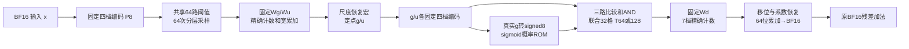

# 最新随机 FFN 的完整 TLM 合同

本版为 Issue179，继续扩展 `unified_v6`。数值算法参考 PR178 / `216f2b9939e9984f140290c98edb05db3aad5c0f`；整机及Attention/RNG/SRAM/DRAM基础代码来自 `d6d33995754fcdcea99286e4ce43f91647aa231a`。代码只模拟事务和时间，不加载权重。

## 一眼看懂流程

入口 x 的四档为 `[S,S/4,S/16,S/64]`；g/u 分别有自己的固定 S，四档为 `[S/2,S/8,S/32,S/128]`。S来自离线校准，推理时没有在线max。g/u相乘只需保留7种指数和，而不是16种完整组合。sigmoid接收真实尺度g的 signed8 编码（步长1/8），不是σ(g/S)。三路比较结果直接AND并送Wd：没有精确SiLU、连续z物化、z均值、z再次编码或第二遍SNG。

**尚未闭合的数值边界：**训练参考在Wg/Wu后仍用FP32恢复。这里为硬件目标明确安排“16位离线系数＋公共输出指数＋64位整数恢复”宏，含运算、时延、状态和未知能量；但离线系数编译与舍入尚未逐位对齐训练代码。因此这版时序可用来检查架构，不能继承之前的PPL/训练精度。面积未知不表示无需电路。

## 阵列如何复用

默认8个64×64 W8阵列，顺序复用来执行GU和Wd，不另外偷偷增加第二套计算阵列。一个输入组先供所有GU输出波次使用，完成整个g/u后编码成紧凑码；Wd再按输入组推进。每个Wd输入组的同一AND事件供全部输出波次使用，通过保存/恢复本地PRNG状态重放。每次重放仍付出T次采样和运算，不存储整个比特流。

Qwen3-4B：D=2560、F=9728，一层W8 FFN权重为 **71.25 MiB**。8个阵列一波只驻留32 KiB，绝不是把全部权重放进小SRAM并行计算。完整GU有12160个64×64 tile，Wd有6080个tile。忽略尾部差异时，GU约1520波，Wd约760波；每波T64/128只是流消费的一部分，另有权重装载、源服务、计数排空、恢复、读改写和依赖等待。

选择输入组优先是为了让所有输出列重放相同事件；本版有明确的GU→编码→Wd屏障，没有声称是最优融合流水。可在后续用固定资源比较输出组优先/跨通道流水，不能把理想重叠直接减掉。

## 宏周期与证据

统一计算/随机接口100MHz，1拍=10ns；校准SRAM仍80MHz，跨域/访问延迟有显式费用。下表都是本版**条件微架构参数**，除特别注明外没有对应完整STA。处理N值、L并行路、首结果延迟d、启动间隔II的宏，周期为 `ceil(N/L)-1` 个II加d；不是整个向量固定d拍。

| 模块 | 默认吞吐/延迟 | 数制、状态或限制 |
|---|---|---|
| 固定四档编码 | 64值/拍，首结果3拍 | 符号/指数、阈值比较、移位/RNE/饱和；无absmax |
| GU/Wd阵列 | 消费II≥1；启动1拍、排空8拍 | 实际源不足会延长；GU4桶、Wd7桶；精确归约，无OR近似 |
| 桶移位归并 | 64桶项/拍，首结果3拍 | 每个输出4或7桶，逐批收费 |
| 16位系数恢复 | 16输出/拍，首结果6拍 | GU系数编译及数值等价待验证 |
| 跨输入tile宽累加 | 32输出/拍，首结果2拍 | SRAM读改写、同地址依赖均保留 |
| 真实g→signed8 | 64值/拍，首结果2拍 | RNE、饱和到[-128,127] |
| sigmoid概率ROM | 16查询/拍，首结果1拍 | 256×9，含概率1端点；按16份复制ROM记状态 |
| 三路比较＋AND | 64通道并行，受随机源II限制 | 192个R8比较接口；直接送Wd，无z缓存 |
| 宽整数→BF16 | 16输出/拍，首结果3拍 | LZC、对齐、RNE；不是已有FP32→BF16模块 |

阵列宏默认帧长度约为 `1+(T-1)×实际II+8`，新的NL随机源还有首响应/分批拼装延迟。GU使用原真实端点协议，其最后响应之后仍计排空。当前计数器小RTL的T32完整帧曾为36拍；本版取更保守的排空参数，并未把36拍当成M64、T128的新测量。

位宽不是全程8位：64输入、W8、T64时每桶保守signed20，T128为signed21；四档/七档对齐后更宽。Qwen3 Wd在16位系数及14位保守对齐合同下，T64/T128需58/59位，采用64位。GU上界只在离线编译保证16位系数和共同指数的前提下成立；这项编译验证待补。

## 真实计入的存储与读写

| 位置 | 本版处理 |
|---|---|
| 外部权重 | 按实际tile地址、字节、64B突发、有限32请求窗口读取；一层各W8权重逻辑载荷读取一遍 |
| 片上SRAM | 有限容量、16bank、16B字、80MHz宏时序、16GB/s公共fabric；全部访存均经过区域检查 |
| 权重本地宏 | 默认32KiB全宽可用容量，明确独立于普通SRAM；从SRAM流式装载到宏，接收带宽不足则拒绝，而不是免费II1 |
| 权重响应缓冲 | 两个bank beat共512B；无隐藏32KiB整波响应FIFO |
| 系数暂存 | 独立小区域，不覆盖权重slot；系数及输出指数保持状态另列 |
| g/u中间值 | 本版保留完整2F×8B宽部分和；随后转为F×4B紧凑非线性码，无连续z |
| 计数器/流水 | 每阵列64输出×7桶×计数位宽；压缩流水寄存器单列代理预算；不是SRAM面积的一部分 |
| 概率码 | x编码16bit/通道；NL有效29bit按32bit存储，当前64通道在本地比较期间保持 |
| 随机流 | 不写SRAM；只保留必要PRNG状态、重放快照和低带宽时的有限响应拼装寄存器 |

可切换 `sram_reread` 对照：不保留全宽权重，每次采样重新读SRAM，时间/流量显式增加。该慢速对照当前只支持 `local_prng_interface`；与实际Issue95逐拍源握手的联合后端尚未实现，配置会拒绝。

## 随机接口的范围

Attention和x入口继续使用原 `IntegratedRandomService`：有限端点、seed、warmup、reseed、SAVE/RESTORE/RELEASE与回压没有被删掉。

**新非线性采用独立有限源宏接口**，没有冒充已接入的实测端点实现：每通道g/s/u分别独立，联合格为4×2×4；每拍64通道需要192个R8字，其中1216bit是真正随机低位，其余高位由格号给出。默认配置10个20字端点等效容量、实际交付192字、II2、响应2拍；原生生成数和丢弃数分开统计。该参数只是可替换合同，不证明特定共享LFSR具有所需独立性。

同一组在全部Wd输出完成前锁定随机子流，重播恢复相同状态。重播种仅在组间执行，种子带宽、启动、暖机和状态均计入。新增源宏当前有独立有限seed端口，尚未连接现有全局seed仲裁；报告单列此限制。若降到每拍20/64字，必须分批，首向量拼装时间和寄存器也计入。

## 已有PPA如何使用

现有数据保留为证据锚点，不能因“已有类似模块”就直接填写完整阵列功耗：

- `counter-38372030-power-recovery`：N64/M1/T32/PIPE1，SS版本B面积48034.8µm²、233.532pJ/帧；存在INCOMPLETE_ACTIVITY告警。未覆盖本版M64/T64/128和7桶Wd。
- `digital-ppa8-20261024-audit`：KIND21是FP32→BF16，SS面积732.96µm²；不等于本版64位整数→BF16。
- `cim-20261024-recovery`：N64/M1 W8门控及buffer，SS面积1290.24µm²、active65.8µW；不含SRAM阵列，完整SNG活动尚有问题。

入口在[统一数字电路台账](https://github.com/rayggxia-workspace/pbit-llm-qwen-baselines/tree/d6d33995754fcdcea99286e4ce43f91647aa231a/digital_circuit_simulation_registry/records)。本任务未新增RTL/PT结果，不重复登记旧实验。

完整面积/能量保持null；未知动作在 `unpriced_actions`，局部状态在 `FFN_contract.local_state`，新增源在 `FFN_contract.nonlinear_random`。已有价格只形成条件小计，不能用来声称最新FFN整机能效提高多少。

## 不变部分及下一步

Attention筛选、赢家保持/校正拒绝、PV采样与K/V读取沿用既有代码。Qwen3只补显式head_dim128、Q宽4096、O输入4096及Q/K归一化；旧Qwen/Llama形状保持原行为。默认DRAM依然是link估计，DRAMSys bridge接口保留，本次未运行该外部模拟器。

优先补齐：GU整数系数编译/舍入与训练oracle对齐；代表性4/7桶、M64、T64/128阵列STA/PPA；本地权重保持/驱动；新增独立随机接口映射。随后再收紧宏参数，而不是把目前缺失项悄悄记成零周期、零面积。
