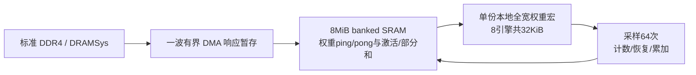

# 统一TLM的标准DRAM与权重供数改进（Issue182）

本版继续维护 `python -m architecture_tlm` / `unified_v6`。研究对象为Qwen3-4B后训练版形状、batch1、2K上下文、一次decode、36层；不含prefill，不是模型质量评测。

## 本次具体改了什么

| 部分 | 历史main设置 | 新的推荐存储配置 |
|---|---|---|
| 外部内存 | Link：16GB/s、80ns、每32突发排空 | 真实DRAMSys：Micron DDR4-1866，双64bit通道、双rank、16GiB |
| DRAM峰值 | 人为设16GB/s | tCK=1.072ns，双沿，合计29.851GB/s；实际由时序/调度/刷新决定 |
| SRAM容量/工艺 | 8MiB、55nm SS、80MHz | 同8MiB、同128个4096×128宏、同SS/80MHz |
| SRAM组织 | 16个并行bank，每bank串深8宏 | 64个并行bank，每bank串深2宏 |
| SRAM公共fabric | 读写合计16GB/s | 读写合计64GB/s；bank端峰值81.92GB/s |
| 本地权重接收 | 256B/100MHz周期＝25.6GB/s | 1024B/周期＝102.4GB/s，足以接收64GB/s |
| 权重生命周期 | 下一波读权重在当前阵列结束之后 | 当前阵列开始时，发下一波DRAM读；上一波恢复完成后再fill/program |
| DMA响应暂存 | 旧路径隐含在阻塞DMA边界 | 新SC路径显式一波容量；8引擎时32KiB，读写成本标为待表征 |
| 本地全宽权重 | 8×4KiB＝32KiB | 8引擎默认仍32KiB；没有免费增加第二份全宽阵列 |
| 数值/算法 | x四档、64分层采样；GU定点宏、三路AND直连Wd；原Attention/随机服务 | 保持相同数值、采样、Attention和随机源合同 |

64bank不是64个双端口：每bank仍按已有1RW宏约束，读写共同争用64GB/s。两个ping/pong地址都交织在全部bank，不把不同地址误算成独立通路。容量更大不会自动缓存更多权重；本版按真实分配和流量收费。

推荐结构沿用常规DMA＋软件管理scratchpad＋本地权重驻留：



这里只把下一波DRAM读取与当前计算重叠。SRAM fill、local program、系数装载仍等待上一波恢复；没有声称把全部访存都隐藏。这样可避免FIFO资源模型提前预约未来fill、反而阻塞当前restore的问题。DMA响应缓存是有限宏：要求可按DRAM返回速率写入、按SRAM传输速率读出；两个方向不同时占有本波，额外时延暂按流式接口包含在DMA/fill内，PPA尚未标定。更细的beat级跨DMA重排、流式写入和银行仲裁是后续改进。

## 阵列是不是太小，为什么分批

Qwen3-4B每层W8 FFN的Wg/Wu/Wd合计71.25MiB，超过整个8MiB片上SRAM，更超过单波本地权重。分批是容量限制下的正常映射。计算tile为64×64 W8＝4KiB，每个引擎每波保存一块权重，在64次采样中重复使用，绝不每个采样拍从DRAM重读。

| SC引擎 | GU波/层 | Wd波/层 | 总波/层 | 36层总波 | 单份本地权重 |
|---:|---:|---:|---:|---:|---:|
| 8 | 1520 | 760 | 2280 | 82080 | 32KiB |
| 16 | 760 | 456 | 1216 | 43776 | 64KiB |
| 32 | 400 | 304 | 704 | 25344 | 128KiB |
| 64 | 200 | 152 | 352 | 12672 | 256KiB |

GU=`40×ceil(304/E)`，Wd=`152×ceil(40/E)`。尾波不足E个引擎会降低利用率，不能简单将时间按E等比例缩小。各方案都做656640个tile，搬运FFN权重2,689,597,440B/token。扩阵列不会减少这些权重字节。

8个引擎每个采样拍合计处理32768个“输入比特×固定权重”位置；理想T64窗口折合512个完整乘积/核心周期，与当前数字参考的512 MAC/周期同量级。GU还有启动/排空，Wd源II=2更慢，不能将这个算式当实际峰值。它说明“波数多”不等于“计算吞吐一定低”；旧8引擎计算忙时约78ms/token，远小于旧约1413ms整机时间，供数才是当前主要矛盾。

本轮引擎扫描保持所有数字QKV/O/lm_head的64KiB分块上限相同；只为更大的SC波扩充其暂存槽，避免把数字算子分块优化混进阵列收益。8、16、32、64不是同面积对照：增加计数器、权重宏、广播负载，面积/功耗必须另外表征。

## 论文怎么处理

- [TPUv1，§2](https://arxiv.org/pdf/1704.04760)：矩阵阵列持有64KiB权重块，另有双缓冲和四块深权重FIFO，从片外DRAM分块搬运；没有要求一次装下全部权重。
- [NVDLA架构规范](https://nvdla.org/hw/v1/hwarch.html)：DMA、片上buffer、算子与流水/FIFO结合；融合可以避免中间结果往返内存。这里借鉴层次与生命周期，未声称照搬其RTL。
- [DS-CIM，§III、§V](https://arxiv.org/html/2601.06724v1)：单宏128×32×8＝32Kb＝4KiB；64路计算复制服务其吞吐设计。不能将其64路并行等同于一个LLM所有权重一次驻留，也不能把误差注入的LLaMA评测当作完整芯片decode调度证明。
- [AccelCIM，§3.2](https://arxiv.org/html/2604.17692v1#S3.SS2)：显式讨论矩阵分块、权重更新和计算/IO重叠；重叠能力需要相应硬件资源。

DS-CIM还通过多个输入向量共享权重获得吞吐。当前batch1 decode每token对每层权重使用一次；prefill或多请求batch可以复用同一权重块，但属于不同工作负载。本版没有把批量吞吐的好处算进单token延迟。

## DRAM模型与功耗口径

配置原字节来源为仓库84c13195的 `architecture_tlm/llama7b/dram/configs/ddr4_2ch_2rank_NoPowerDown_core_limits.json`。本版保存相同文件和PROVENANCE，采用Open-page/FR-FCFS、32个bridge outstanding突发，DRAMSys内部按实际bank/row/refresh时序工作。一个DMA内部滚动补充请求；不再人为每32突发排空，但宏DMA之间仍有完成屏障。

使用DRAMSys5.6/SystemC3/DRAMPower6.3.1既有audit bridge。功耗来自修正的Micron core-current限值配置，VDDQ=0是**I/O/PHY未计**，不是I/O无功耗；控制器、PHY和板级外围不在DRAMPower core边界。没有把原64pJ/B＋50mW代理单价叠加到真实DRAMPower结果。

NoPowerDown先作为统一可复现标准。低功耗策略可以另做同配置对照，本轮不把低功耗收益揉入调度收益。

## 使用与证据

```sh
export PBIT_DRAMSYS_BRIDGE=/absolute/path/to/pbit_dram_bridge_sg_v6_audit
python -m architecture_tlm --memory-profile balanced_ddr4 --attention exact --output output/new_case
# 重现旧链路边界：
python -m architecture_tlm --memory-profile legacy --attention exact --output output/legacy_case
```

缺少真实DRAMSys可执行文件时，新profile明确报错，不静默回退Link。源代码和官方配置在执行前冻结；远端Slurm仅用CPU。旧结果原件不覆盖。

结果见本目录 `RESULTS_MEMORY_ZH.md`（执行完后填写）与 `work/jieruiz/182/HANDOFF.md`。目前已通过72项机制/回归：权重不覆盖、>=3次槽复用、预取重叠、单/双缓冲工作量相同、容量/端口负例、数字分块独立。真实DRAMSys小基准已完成，全模型正在接续执行。

已知边界：SRAM内部宏面积与动态能量有库依据，加宽接口/CDC/布线、DMA响应buffer、本地全宽权重宏、新FFN计数/恢复与随机非线性仍有未标定PPA。因此完整芯片面积/能耗保持unknown；本次不提供新PPL，不声称全局最优或全芯片周期精确。
