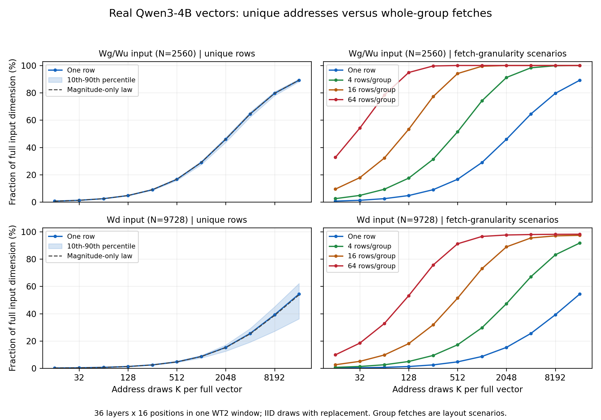

# FFN地址采样：采样次数与地址并集的真实数据分析

2026-11-22；Issue #261；负责人 rayggxia。

**结论：行级地址并集在几百次采样下远未覆盖全集，但连续64行整组搬运会很快接近全量。** 新方法能否减少外存权重流量，既取决于需要多少地址样本，也取决于是否能只读取被选中的输入行。

## 1. 数据与统计对象

- 模型：已训练100M token的Qwen3-4B T64 checkpoint；36层，隐藏宽度2560，FFN宽度9728。模型仓库revision为 `fa0a9e4a7ad394ffb60e8175cb0d1e34dff93caf`，子目录 `submissions/20261031T115253Z-xhy12309-seven-case-weights/models/t64`。全部36份FFN和匹配non_ffn权重SHA见 `results/CAPTURE_RESULT.json`。
- 输入：完整WT2原始语料中的第一个2048-token窗口，取每层16个位置，合计每种信号576个完整向量。位置涵盖31至2015，历史长度不同；不是576个独立完整2K请求，也不是完整WT2评测。
- 沿用已核验部署快照：前级分层T64、后级4×4×4联合分层、seed101，Attention保持该冻结部署的原实现；没有换为本轮地址采样前向。此次不比较Attention方案。
- Wg/Wu入口：2560维，主表采用已有四档P8编码后的条件均值 `x_p8mean`；另保留接口原值 `x_raw`。
- Wd入口：9728维，主表采用已编码g/u与P8 sigmoid概率的乘积 `z_p8mean`。这是原事件路径的编码均值，不是另算FP32精确SwiGLU。另统计现有T64有限采样输出 `z_sample`，避免把它的额外零值当成天然稀疏性。
- 权重范数来自实际W8定点码和各tile二次幂尺度解码后的权重。Wg/Wu共同取每个输入方向的联合L2范数；Wd取相应输入方向的L2范数。
- 捕获只读：整个窗口logits与未插钩子的同配置前向逐位一致；与历史捕获的3层×x/g/u共9项也逐位一致。

## 2. 采样规则与计算方式

每个完整输入向量分别构造两种地址概率：`p_i ∝ |v_i|`，以及 `p_i ∝ |v_i| × rho_i`，其中rho为上述真实权重范数。每次抽一个地址，独立、有放回，K是整个2560或9728维向量的总抽样次数。下文主表使用后一种重要性概率。
这里按真实输入构造理想categorical地址分布，尚未将该新地址分布压成8位阈值，也没有回放赢家保持/拒绝上限/相关地址流。P8指被分析的原FFN数值接口，不表示新地址采样器已经实现P8电路。因此本结果用于先判断地址覆盖机制，不作为该新采样器的硬件验收。

给定真实概率，唯一地址数的精确期望为：

`E[U(K)] = sum_i [1 - (1-p_i)^K]`

先对每个真实向量计算，再对576个向量平均。占比分母始终是完整维度2560或9728，不是非零地址数。三个seed（17/503/1009）在层0/17/35的全部48个位置向量上抽样核对；最大“平均覆盖率”偏差为 **0.228个百分点**，比较的是对应48向量的解析期望。分位带表示不同真实向量的分布，不是置信区间。

## 3. 地址并集随K变化

| 地址抽样次数 K | Wg/Wu 唯一行 | Wd 唯一行 | Wg/Wu：64行整组 | Wd：64行整组 |
|---:|---:|---:|---:|---:|
| 16 | 0.62% | 0.16% | 32.67% | 9.83% |
| 32 | 1.23% | 0.33% | 54.15% | 18.41% |
| 64 | 2.42% | 0.64% | 78.31% | 32.71% |
| 128 | 4.71% | 1.26% | 94.88% | 53.19% |
| 256 | 9.00% | 2.45% | 99.66% | 75.63% |
| 512 | 16.62% | 4.66% | 100.00% | 91.18% |
| 1024 | 28.96% | 8.62% | 100.00% | 96.58% |
| 2048 | 45.97% | 15.28% | 100.00% | 97.63% |
| 4096 | 64.47% | 25.51% | 100.00% | 97.97% |
| 8192 | 79.60% | 39.20% | 100.00% | 98.13% |
| 16384 | 89.21% | 54.37% | 100.00% | 98.21% |

前两列是真正选中多少不同输入方向。后两列是假设：任意一行被命中，就必须搬入它所在的连续64行，并在同一向量的所有K次采样间复用。它们是明确的读取粒度场景，不是已经测得的当前DMA流量。

## 4. 读取粒度为何决定收益

2560维只有40个64行组，9728维只有152组。地址分散在不同组里，少量不同地址就能命中大量组。因此，K128时虽然Wg/Wu只选择约120行，64行组搬运已接近95%全量；Wd约123行，却要覆盖约53%的64行组。K512时，Wg/Wu组覆盖接近100%，Wd超过91%。

| K | 连续组大小 | Wg/Wu需搬入的行比例 | Wd需搬入的行比例 |
|---:|---:|---:|---:|
| 128 | 1 | 4.71% | 1.26% |
| 128 | 4 | 17.47% | 4.94% |
| 128 | 8 | 31.83% | 9.57% |
| 128 | 16 | 53.29% | 18.04% |
| 128 | 64 | 94.88% | 53.19% |
| 512 | 1 | 16.62% | 4.66% |
| 512 | 4 | 51.42% | 17.17% |
| 512 | 8 | 76.17% | 30.98% |
| 512 | 16 | 94.09% | 51.38% |
| 512 | 64 | 100.00% | 91.18% |

这里的一行是“一个输入通道对应的完整输出权重向量”：Wg/Wu合计2×9728个W8权重（19,456B），Wd为2560个W8权重（2560B），不包括尺度元数据。若物理存储能按这类向量顺序流式读取，被选中的一行本身已足够长，不必因单次DRAM突发而必然多取另外63行。现有64×64 tile布局能否支持这种访问，需要重排或地址映射验证，不能直接把整组场景视为必然结果。

仅按这一层的W8权重有效载荷、同一输入方向在所有输出间复用、重复地址可去重时，行比例也等于相应矩阵的有效权重字节比例。这没有包含突发碎片、地址队列、其他模块、索引和概率生成成本，因此不是整机DRAM或能量降幅。若不同输出tile各自独立抽样，所有tile的地址并集会进一步扩大；要维持上述收益，须共享该输入向量的地址序列。

## 5. 输入幅度与权重范数加权的差别

本批数据中，两种概率的覆盖曲线很接近。K128时：

| 概率规则 | Wg/Wu唯一行 | Wd唯一行 | Wg/Wu 64行组 | Wd 64行组 |
|---|---:|---:|---:|---:|
| 仅输入幅度 | 4.72% | 1.26% | 94.90% | 52.47% |
| 输入幅度×权重范数 | 4.71% | 1.26% | 94.88% | 53.19% |

这说明权重范数修正在本次覆盖率统计中没有让地址显著集中；不说明它对输出估计误差没有帮助。后者必须评估同K下的输出误差和模型PPL。

## 6. 与原有随机比特流采样次数的区别

**新方案的K128，不等于原FFN的128拍比特流。** 新方案每次只选一个输入地址；旧方案每拍可让多个输入通道同时为1。仅由计数上限可知，新方案K128最多覆盖2560维的5%、9728维的1.32%；覆盖少不等于输出误差小，更不能继承旧T64/T128的PPL。

统计还表明：在逻辑行级，数千次抽样后也没有立即覆盖全集，Wg/Wu K4096约64%，Wd约26%；但64行整组读取早已接近其可达上限。Wd部分向量包含编码零值，因此64行组覆盖的总体均值上限略低于100%。

后续应先保持Attention与其他路径不变，对地址采样的Wg/Wu、Wd分别测输出误差和PPL，再确定达到质量目标所需K；同时验证行向量布局、重复地址合并、跨输出共享地址序列。当前证据已足够判断“并集会不会接近全集”，尚不能确定可以节省多少整机能量。

## 7. 复现与证据入口

- GPU捕获：Slurm6094，282.02秒，成功；CPU分析：Slurm6099，成功。6096仅启动路径错误，在执行分析前退出，原日志保留；未重复运行模型。
- 原始完整张量：私有服务器 `/home/Hongjie_Zeng/projects/ffn-address-coverage-issue261-20261122/result/capture.npz`，33,035,912B，SHA-256 `8213fdd53b66b9dded08e9e70a2fd4d2c2cd53e32f47c93d0d2c7b7ac7031c37`。不上传Git。
- `results/RESULTS.json` 记录两种分布、440项汇总、输入/权重/语料/运行源码身份和CSV SHA；`COVERAGE.csv`为总表；`PER_LAYER.csv`为逐层表；`MC_THREE_SEEDS.csv`为三seed核对。
- `work/rayggxia/261/SUBMISSION.json`与`HANDOFF.md`记录执行快照、版本、命令和下一步。
- 离线核验：`python experiments/ffn_address_coverage_20261122/test_coverage.py`；重新画图及生成本报告：`python experiments/ffn_address_coverage_20261122/render_report.py`。后者需要NumPy和Matplotlib，前者只需NumPy。
