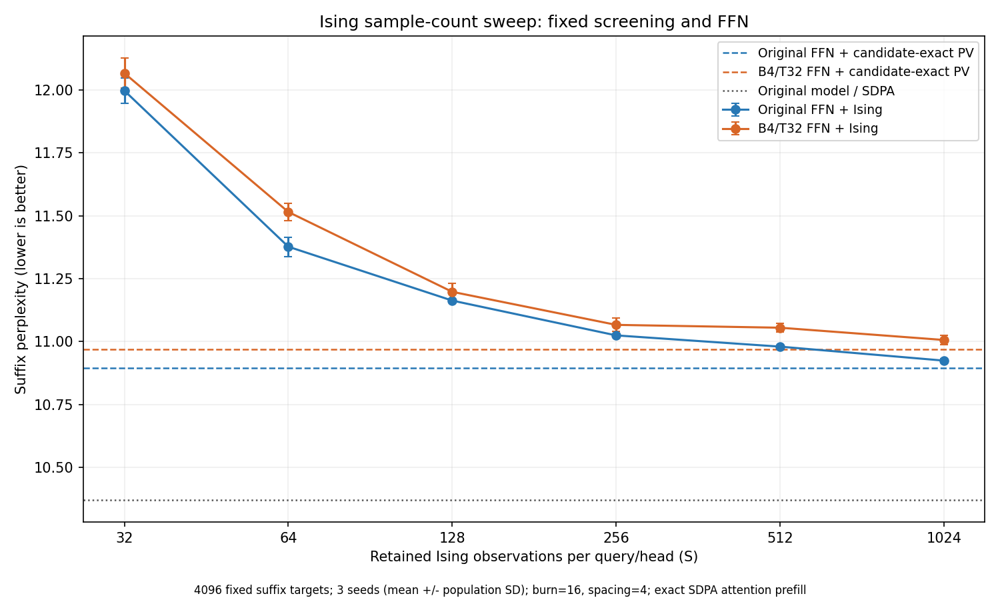

# Ising观测次数与PPL：固定四档32拍FFN

Issue50 / [PR52](https://github.com/rayggxia-workspace/pbit-llm-qwen-baselines/pull/52)，2026-10-19，负责人jieruiz。本次只评估PPL，未追加任务基准、训练或硬件能效估算。

**原有完整联合任务用S128；此前联合后缀测过S128和S512。本次补齐S32/64/256/1024及筛选后准确PV，固定FFN与其他Attention设置。** S为每个query/head保留的Ising观测数；预热16、观测间隔4固定，观测时刻16+4k，k=1..S。它不是器件更新次数，也不是独立有效样本数。

## 结果总表

全部为同一32段×128目标＝4096目标的固定后缀PPL，初始context2048、batch8、seed0/1/2；±为三个种子的总体标准差，不是语料置信区间。越低越好。

| Ising观测数S | 原始FFN＋相同Attention | 四档32拍FFN＋相同Attention |
|---:|---:|---:|
| 32 | 11.996331 ± 0.050601 | 12.065755 ± 0.059786 |
| 64 | 11.376921 ± 0.038391 | 11.514886 ± 0.034470 |
| 128 | 11.163005 ± 0.007407 | 11.197813 ± 0.032905 |
| 256 | 11.024839 ± 0.004998 | 11.066594 ± 0.026234 |
| 512 | 10.980212 ± 0.001083 | 11.055307 ± 0.017385 |
| 1024 | 10.924655 ± 0.008958 | 11.006579 ± 0.017572 |
| 筛选后准确Softmax＋准确PV（无Ising） | 10.895520 ± 0.013527 | 10.970368 ± 0.017011 |

原始BF16/SDPA匹配基线 **10.371557**；仅替换四档32拍FFN、Attention原版 **10.427377 ± 0.012884**。FFN的32拍与Ising的S是两个独立参数。上表不是完整WT2，不能直接减去原全量11.65。

## 变化说明

- S32→S64：联合PPL 12.065755→11.514886，变化-0.550868。
- S64→S128：联合PPL 11.514886→11.197813，变化-0.317074。
- S128→S256：联合PPL 11.197813→11.066594，变化-0.131219。
- S256→S512：联合PPL 11.066594→11.055307，变化-0.011288。
- S512→S1024：联合PPL 11.055307→11.006579，变化-0.048728。

只看本轮后缀PPL，1024次最低。256与512的均值仅差约0.011，小于两组各自的seed标准差；目前没有清楚的质量差异证据，但这不证明二者等价。是否可用256代替512，继续用完整WT2确认。

S1024与同筛选准确PV参考的PPL差为+0.036211；该准确PV是取消候选内随机估计的诊断参考，不是数学上的PPL下界。筛选仍存在，筛选候选可以随模型hidden和独立筛选随机流变化。不能由这条曲线宣布继续增加S必然无用，也不能把全部剩余损失归于Ising。

S可以大于最多512个候选，因为链可反复观测同一类别；这里没有要求选出S个互不相同的token。相邻重复包含注意力分布集中与链相关两种因素，不能直接据此计算ESS。

## 只改变了什么

全24层FFN保持B4/T32/K32、历史固定INT8权重、A8共享64路分层输入/乘积编码；SiLU(g)×u仍连续FP32，接口BF16。FFN的prefill/decode均替换。计分query的24层Attention均实际执行max4概率筛选、固定8块修补、候选准确QK、有限hard-onehot CTMC Ising、按索引直接选择并平均V。Attention多token prefill仍准确SDPA。没有先准确Softmax再冒称Ising，也没有重复PV抽样。

不同S的burn、spacing、候选预算、筛选train校准、FFN和计分位置均不变。三seed全部保留，不选择最好的seed。随机域分离，但不同S的真实hidden及CTMC事件消耗会改变轨迹，不宣称所有输出随机数完全配对。

## 全量确认

此前Slurm2430的22项完整cached对照仍按原53dd快照运行，含B4T32的S128及原BF16/FFN-only；不修改或重交。新S256/S512各3seed完整确认：Slurm2461已提交6项，未收齐。完整计分为299077目标、window2048/stride1024、batch32，所有计分query真正触发替换；完整任务未收齐时不填写其PPL。新完整任务复用已通过的实际32×1023显存门禁，并核验数值内核源码未变。

## 来源与复现

新15项后缀执行源c0fd54446d843f0b21e94bf138c692048e518c86；Slurm2440重新核验模型/语料与原BF16后缀参考10.37155678462956，再由Slurm2441评估。已有B4T32 S128/S512及FFN-only来自原Issue50/d61，不重复计算。原FFN曲线来自成员Issue48/PR49的公开固定8块结果：publication8dd1b06a、execution11f1d6ee、Slurm2380；并非本次重新运行。

references保存原始公开summary/ARTIFACTS/input核验与独立SHA导入记录。原FFN参考与本任务的权重、模型revision、测试文本/token/目标位置、batch以及基线相同；两边配置/分词器部分原文件的字节不同，已在IMPORT_IDENTITY记录，不能称全部输入逐字节相同。重叠的原FFN S128/S512均值与本任务已有结果完全一致。

SUMMARY.json保留各seed和逐段NLL；ARTIFACT_INDEX.json索引新/复用原件路径、大小和SHA；模型、文本、runtime校准及大原件保留本人授权服务器，不重复上传。数值输入、配置SHA、环境、24层执行audit均在摘要或原件中。离线统计使用experiments/qwen_joint_stratified_attention_20261019/summarize_sample_sweep.py；收集使用collect_results.py。

