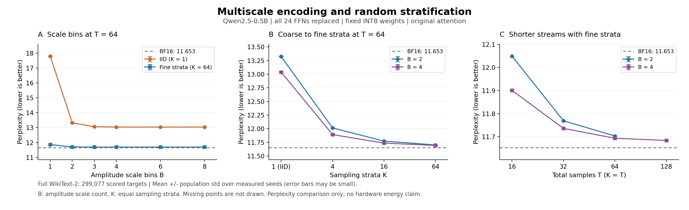

# 多档缩放和分层采样：完整WT2对照

Qwen2.5-0.5B，全部24FFN替换、原BF16 Attention，固定同一W8，无训练。原BF16 **11.652735**，完整WT2 299077目标；以下随机项均3seed均值±总体标准差。

## 主要判断

1. **缩放与分层应结合。**4档IID64为13.038027，4档细分层64为11.693775；只做dynamic64范围的细分层64为11.768589。二者单独都有效，叠加后更接近原BF16。
2. **3～4档后收益已饱和。**同64次细分层，2档11.703316、3档11.692746、4档11.693775，6/8档也约11.694；不能因微小均值差宣称3档有普遍统计优势。若优先硬件简化，2档是有吸引力的候选（1bit档号，另有符号/端点）；3/4档是更低损失候选。当前未测3档T16/32，不能继承4档短流结果。
3. **粗分层确实仍有用，但更细覆盖可以换成更短流。**4档、T64/K16为11.736863，与T32/K32的11.736131几乎相同；T64/K4为11.893101，与T16/K16的11.900826也接近。若同样质量，优先考察更短T，而不只追求较小K。
4. **当前建议保留两档T32和四档T32作主要硬件候选。**两档T32相对BF16增加0.999%，四档T32增加0.716%；四档T16增加2.129%为更激进选项，四档T64增加0.352%为更低损失选项。此前“128次折中”的判断仅针对IID，不适用于新增分层方案。

同W8、FP32 FFN无激活编码控制为11.681130，各档无采样控制约11.680～11.687。这支持有限流误差是本轮主要可改进项，但不能将该控制和BF16之间的全部差异称单独权重量化损失。

分层仍需要区间调度，K=T时可用当前采样计数器产生高位、物理随机位提供低位；“分得更细”未必增加很多独立状态。若已有帧计数器，值得验证复用。相同T只改K并不缩短阵列周期；以上采样长度优势尚非整机能量/面积测量。

## 1 同样64次采样，多少幅度档合适

| 幅度档数 | 自然IID，K1 | 细分层，K64 | 无采样编码控制 |
|---|---:|---:|---:|
| 1 | 17.800039 ± 0.013904 | 11.861552 ± 0.003298 | 11.687004 |
| 2 | 13.324329 ± 0.008113 | 11.703316 ± 0.001176 | 11.681804 |
| 3 | 13.064200 ± 0.014960 | 11.692746 ± 0.000593 | 11.679900 |
| 4 | 13.038027 ± 0.010666 | 11.693775 ± 0.001432 | 11.680940 |
| 6 | 13.036766 ± 0.011718 | 11.694073 ± 0.000768 | 11.682111 |
| 8 | 13.038505 ± 0.012030 | 11.693854 ± 0.000628 | 11.681139 |

dynamic64 absmax对照：IID64 **14.559275 ± 0.005839**；K64细分层 **11.768589 ± 0.003298**。它与单档PoT的顶档/端点不同，分别标记。

## 2 缩放后是否还要细分层

| 采样区间数K，总T64 | 每区间采样数 | 2档PPL | 4档PPL |
|---|---:|---:|---:|
| 1 | 64 | 13.324329 ± 0.008113 | 13.038027 ± 0.010666 |
| 4 | 16 | 12.015205 ± 0.002574 | 11.893101 ± 0.003607 |
| 16 | 4 | 11.773086 ± 0.002320 | 11.736863 ± 0.004758 |
| 64 | 1 | 11.703316 ± 0.001176 | 11.693775 ± 0.001432 |

K1为自然IID；K>1是等额覆盖各门限区间、区间内部有放回的随机抽样。幅度档数B与采样区间K是不同参数。相同T时分层不减少阵列拍数；降低T后才可研究系统时间/能量收益。

## 3 细分层还能将总采样缩短多少

| 总T与K | 2档PPL | 4档PPL |
|---|---:|---:|
| 16 | 12.048887 ± 0.000542 | 11.900826 ± 0.003825 |
| 32 | 11.769199 ± 0.001183 | 11.736131 ± 0.000243 |
| 64 | 11.703316 ± 0.001176 | 11.693775 ± 0.001432 |
| 128 | 未测 | 11.683928 ± 0.000383 |

T16/32未测同T IID，因此这些行给出实际可达到的质量，不能作为同T分层提升的数字。64和128次可与同协议IID结果对照。

细分层T64的计数在幅度码层面等价于floor(q/4)加一个共享随机余数事件，T32/T16则对应q/8、q/16的随机余数；结合每元素幅度档，可理解为多尺度低位无偏舍入。它依然使用层内随机低位，但依靠受控区间覆盖，不能把这些分数说成自然IID矩阵已达到同样精度。是否值得物理展开T拍，还需与直接随机舍入＋低位确定矩阵比较电路成本。

## 4 证据与限制

新执行源`db27fa3d7ed8eced13513f0cad10061a3cc59a71`，Slurm2308/2309；69项计分（67配置＋2BF16）、72服务器原件全部收齐。模型/分词器/文本/token/冻结依赖与前两批同字节，原BF16精确复现。新13项核测试、旧12项multiscale、8项range及shared测试通过。K1与旧IID输出及RNG状态严格一致，fine/coarse均验证共享相关性及跨层独立性。

本表补齐的IID64 B1/2/3/6来自新源；dynamic64/B4/B8的IID64导入a7bae630批次，B4/B8无采样控制导入e6f29b1批次。COMPARISON.json逐组记录来源，旧原件与SUMMARY不覆盖。SUMMARY/ARTIFACT_INDEX只对应新69项；STRATIFIED_VALIDATION/清单见work/jieruiz/46。

这是探索性参数比较。只能称已测配置中的表现，未证明B5/7或其他K不更好；同一WT2选参不等于独立泛化验证。局部线性方差降低不保证整网PPL单调。SiLU(g)×u仍连续，FP32恢复，不是新物理随机源实测或有限宽RTL。

此前分层完整结果属于Llama2，不与本表绝对PPL直接排名。[文献核查](LITERATURE_ZH.md)区分DS-CIM无PPL、小型RNN的真实PPL与尚未获取原件的公开代码声明。
