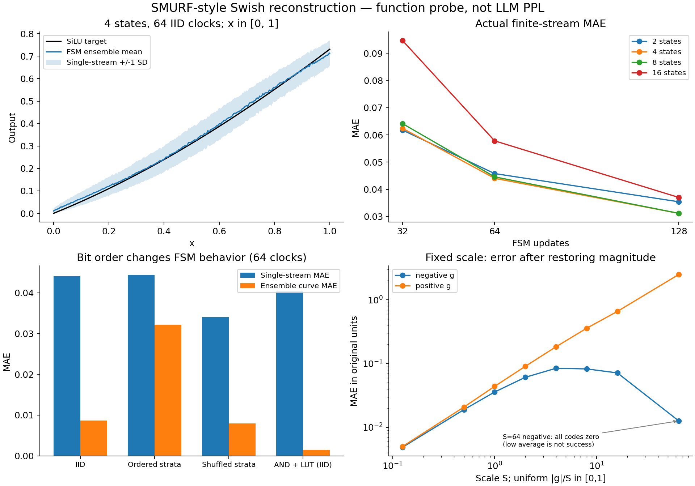

# SMURF Swish短流重建与固定W8接口核验

日期：2026-10-24。负责人：jieruiz。Issue175，依赖PR174的FFN接口背景。**本轮完成51组函数级配置；没有Qwen PPL、训练或RTL/PPA。**

## 可以直接得出的结论

1. 我们重建的4状态、P8比较器、64拍IID版MAE为 **0.044052**；输入改为独立随机排列的32层、每层2次后约 **0.033992**。后者接近原文0.033，但属于我们的改造，不证明原文采用此序列。
2. 原文图9横轴是 **0～1**，纵轴终点约SiLU(1)=0.731；0.033是MAE，不是相对误差，更不是整个Qwen或负半轴误差。不能把“64位流”说成64位精度。
3. 固定W8可保留；不能把带不同位权、符号、尺度的原始部分流当成等权Bernoulli输入直接送普通SMURF。进入非线性前仍需合并/编码。
4. FSM不是无状态概率映射。时序顺序会改变结果；增加状态数也不保证64拍更准。它目前没有证明优于我们的分层AND路径，更没有证明整机节能。

## 重建条件与证据边界

一手来源：[SMURF arXiv v1](https://arxiv.org/html/2405.02356v1)，§III、§IV-A及图9；[作者出版入口](https://mengli.me/publication/aspdac-2025-stochastic/)确认ASP-DAC 2025。PDF原件SHA见config.json及本机project_archives/smurf_swish_20261024/2405.02356v1.pdf。阅读了图9实际坐标，不把图3的通用映射例子当作Swish范围。

公开v1没有给出Swish专用系数、状态数/复位/预热/seed/重复统计的完整组合；本次未找到可直接运行的作者复现代码。因而本结果是**依公开方程的独立重建**，不是逐参数复现作者0.033。本文与原论文未公开条件之间的差距不能据此判断论文错误。原文电路成本采用另一双变量函数，未挪给本Swish。

执行源码提交：`ba7ff03dd9d35050788f12ea476fd9428396c87b`。Python 3.8.1，NumPy 1.24.4，SciPy 1.10.1。配置、源码、合成输入网格及结果SHA在MANIFEST.json。无模型/语料，所以模型revision、BF16参考、数据集PPL为不适用。

主测试q=0..256共257点，p=q/256；每点每seed256条独立流，3个seed，共768条。所有流从N//2复位，**零预热**，32/64/128个真实状态更新，更新后读输出。每条流均单独计算误差再平均，不能先平均768条输出再报其较小误差。有限时间Markov均值与二阶矩独立校验模拟结果；配置扫描包含12主测试、4敏感性、3AND对照、32带符号尺度测试。

运行：`python qwen3/smurf_swish/test_core.py`；`python qwen3/smurf_swish/run.py`；`python qwen3/smurf_swish/report.py`。run要求四个核心源码/配置与HEAD原字节一致。运行前检出执行提交可精确重放；后续HEAD只改报告不改执行文件时也可运行，但manifest会记录实际HEAD。

## 状态机实际每拍做什么

输入门限q是8位幅度码（256为额外true-one端点），比较独立R8得到b。状态j遇b=1加1，b=0减1，饱和在0..N-1。状态选择一个固定概率门限theta[j]，用另一个独立R8比较产生输出bit。**不是先算精确SiLU再从该概率抽样。**

离线用稳态分布pi[j]正比于(p/(1-p))^j，拟合sum(pi[j]*theta[j])到p*sigmoid(p)，约束theta在0..1，最后RNE成P8；p=0/1分别为边界吸收态。4状态系数码为 `[1,136,0,182]`，有2位状态寄存器、4个固定门限、输入及输出比较。代码选择当前门限再比较，在独立门源假设下与各门独立生成后MUX有相同分布；没有实现作者共享/延迟随机字的相关性。

64拍是**该FSM输出64个bit的更新拍数**，不是全FFN拍数。如果先用64拍完成Wg/Wu并形成g/u码，再启动64拍FSM，则两个阶段至少128拍，另加归约、缩放、设置和流水线延迟。u流AND与Wd可以接在FSM输出后逐拍工作，不必等FSM帧结束重新编码z。是否每拍完成反馈须RTL/STA确认，本轮不宣称实际频率。

## 数值结果

### 原图正半轴：单条流MAE

| 状态数 | 32拍 | 64拍 | 128拍 |
|---|---:|---:|---:|
| 2 | 0.061751 | 0.045799 | 0.035439 |
| 4 | 0.062395 | 0.044052 | 0.031188 |
| 8 | 0.064131 | 0.044585 | 0.031203 |
| 16 | 0.094625 | 0.057807 | 0.037034 |

这说明状态数更大可能导致启动偏差增加。4状态64拍精确有限时长平均曲线MAE为0.008667，但单条流误差为0.044052；后者才包含有限采样噪声。

### 顺序与当前非线性子路径的对照，均64拍

| 方案 | 单条流MAE | 多次平均曲线MAE |
|---|---:|---:|
| FSM：独立IID | 0.044052 | 0.008669 |
| FSM：32区间顺序分层 | 0.044376 | 0.032165 |
| FSM：32区间独立随机排列 | 0.033992 | 0.007907 |
| 两独立流AND＋P8 sigmoid表 | 0.040283 | 0.001459 |

分层敏感性保持同一组稳态拟合系数，不重新为分层拟合。32个8宽区间每轮各用一次，64拍两轮；shuffle版本每条流每轮独立Fisher-Yates排列，区间内R3随机。**不是前级固定顺序分层可直接连接。** 实际硬件的排列发生器/状态成本尚未估算，不把它免费计入已有随机源。输出门仍IID。AND对照用离线P8 sigmoid表＋独立输入幅度流，两流AND模拟SiLU正半轴；这里还未乘u，也不是整个FFN成本比较。它的64拍MAE0.040283低于本次IID FSM，不能宣布FSM精度更优。

### 面向g/u的符号与固定尺度扩展

用g=sign*S*p，FSM目标概率为p*sigmoid(sign*S*p)，最终输出表示sign*S倍的随机bit。每个S/符号独立离线拟合系数；没有在线重新拟合或动态max。下表是4状态、64拍IID，在原数值单位恢复后的MAE，p均匀取129点，每点3×128条流；不是模型激活分布加权结果。

| S | 正g MAE | 负g MAE |
|---|---:|---:|
| 0.125 | 0.005002 | 0.004867 |
| 0.5 | 0.020785 | 0.018931 |
| 1 | 0.043875 | 0.035775 |
| 2 | 0.090540 | 0.060951 |
| 4 | 0.183527 | 0.084339 |
| 8 | 0.358866 | 0.082441 |
| 16 | 0.658636 | 0.071407 |
| 64 | 2.501963 | 0.012590 |

**S=64负分支的P8系数全部量化为0**，此时低平均误差来自大部分均匀区间的SiLU接近0，不能称为成功保留负SiLU谷值。正分支恢复后的误差随S放大，说明多档选择/实际激活分布与模型PPL仍需验证。正负/尺度专用系数也需要存储或逻辑选择，不能只用一个为S=1拟合的表覆盖所有尺度。



## 为什么固定权重的位平面不能直接喂给普通FSM

固定W8每拍的结果是带权的整数部分和。例如各位平面的计数C_j必须形成 `sum_j (2^j*C_j)`，还要处理符号与输入尺度；每个C_j可大于1。单个权重1和64都可能只在一个位平面输出1，但它们贡献分别为1和64，丢弃位号就丢失数值。

普通SMURF的一次输入只有一个0/1，概率代表归一化后的**整个g**。因此不能将各位平面等权串接，也不能分别Swish后再加权，因为 `SiLU(a+b) != SiLU(a)+SiLU(b)`。即使逐拍先做准确带权和，再把每拍随机部分和当作最终连续g做非线性，也不等价：x~Bernoulli(0.5)、w=2时，SiLU(E[wx])=0.731059，而E[SiLU(wx)]=0.880797。

可实现的两条接口：

```text
推荐先验证的接口（固定W8继续保留）
输入bit -> Wg/Wu固定权重与门 -> 位平面计数/带权归约
        -> 时间累加/跨尺度对齐 -> 固定点g/u -> 幅度码+符号+尺度
        -> g幅度SNG -> Swish FSM -> 与独立u幅度流AND
        -> Wd固定权重与门 -> 按符号/尺度对齐 -> 最终输出累加
```

这里g/u中间统计没有消失；FSM替换的是局部非线性概率变换。g/u可由宽整数累加后定点缩放得到，不要求电路FP32。目前PR174 gate/up仍有FP32参考恢复，不能把本函数模块视作该边界已完成bittrue改造。

另一条研究路线是整数随机计算：每拍先合并位平面，得到signed integer，再用每拍多步跳转的FSM。文献[Integral SC](https://arxiv.org/html/1509.08972v2)有这类NStanh结构；但其量程、步长和状态分布不同，不能直接套本次SMURF的系数或0.044误差，尚未实现。

将权重也随机化，虽每个乘积可用一个AND表示，**矩阵跨连接求和依然存在**。所以双随机并不自动解决接FSM的问题。若用MUX/随机选择将和重新变成单比特流，也要承担求和缩放、抵消、相关性及重新编码成本。

## 验证及下一步

8项测试覆盖：稳态不变性、有限输入输出序列穷举的均值与方差、Monte Carlo对数学矩、概率端点/seed重放、分层区间覆盖、符号W8位平面等价、尺度与非线性不可交换、位宽/采样预算。51组结果manifest/解析RMSE交叉校验通过。合成探针只按已知q条件运行，未包含前级矩阵误差或跨通道共享、未验证实际器件时序相关。

建议保留4状态与分层变体作候选，而不立即替换现有短流AND主线。下一步如进入模型，应使用实际g/u固定尺度、冻结门限和真实序列，保持前级W8四档64次不变，再比较联合直连Wd PPL；同时为排序/状态/系数存储和g/u边界统计计费。本次仅交付函数级复现，不声称这一步已经完成。
