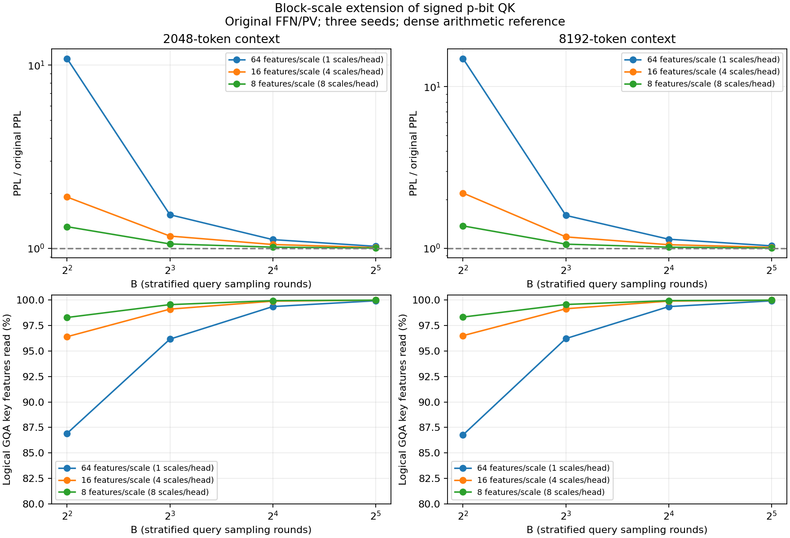

# 分块尺度p-bit QK：论文基础方案的扩展对照（2026-10-06）

## 与原文的关系

这不是原论文第5节基础方案的原样复现。原方案为每个query头统一尺度；本轮改成RoPE后连续特征块各自取absmax尺度。
每头64维，block=64/16/8分别对应1/4/8个尺度。保留block64作为论文式对照，原始实验源码和结果未改动。
编码仍为b_i~Bernoulli(abs(q_i)/a_block)，另存符号，B轮后乘回a_block/B。每维期望仍为q_i，故线性QK估计无偏。
只替换24层decode QK；连续K、原始PV/FFN、投影、RoPE和精确prefill保留；无训练。

## 对照协议

2k：32个WT2片段、2047 token精确prefix、128步缓存teacher-forcing，4096计分token。
8k：16个片段、8191 token精确prefix、128步，2048计分token。位置和上一轮完全相同。
分层采样B=4/8/16/32，块大小64/16/8，每配置3个推理seed，外加四个密集基线，共76项。
±为推理seed总体标准差，不是独立文本置信区间。追加改进仍使用同一测试集，结果为探索性比较。
50000次概率测试验证不同块尺度的均值和解析方差，检查零块，并确认block64与旧编码逐位一致。
缓存集成检查通过；76项源码/FFN/文本哈希、计分位置和PPL计算核验通过；所有block64逐seed PPL精确复现旧结果。

## 结果

### 起始上下文2048

原始SDPA PPL：10.373559。

| 块维度 | 尺度数/头 | B | PPL均值 ± 标准差 | 相对原始增加 | GQA组Key访问 | 加减事件/原始MAC项数 |
| ---: | ---: | ---: | ---: | ---: | ---: | ---: |
| 64 | 1 | 4 | 112.637641 ± 0.544938 | 985.81% | 86.91026% | 0.463 |
| 64 | 1 | 8 | 15.821101 ± 0.251467 | 52.51% | 96.16688% | 0.906 |
| 64 | 1 | 16 | 11.572424 ± 0.078649 | 11.56% | 99.36521% | 1.799 |
| 64 | 1 | 32 | 10.634896 ± 0.032451 | 2.52% | 99.93364% | 3.594 |
| 16 | 4 | 4 | 19.760684 ± 0.045096 | 90.49% | 96.40397% | 1.161 |
| 16 | 4 | 8 | 12.099608 ± 0.013696 | 16.64% | 99.11189% | 2.309 |
| 16 | 4 | 16 | 10.882335 ± 0.053196 | 4.90% | 99.89635% | 4.606 |
| 16 | 4 | 32 | 10.476374 ± 0.013364 | 0.99% | 99.99457% | 9.203 |
| 8 | 8 | 4 | 13.612821 ± 0.111341 | 31.23% | 98.29195% | 1.600 |
| 8 | 8 | 8 | 10.959739 ± 0.061139 | 5.65% | 99.55701% | 3.194 |
| 8 | 8 | 16 | 10.528634 ± 0.019697 | 1.49% | 99.94490% | 6.384 |
| 8 | 8 | 32 | 10.410632 ± 0.017377 | 0.36% | 99.99698% | 12.765 |

### 起始上下文8192

原始SDPA PPL：9.418982。

| 块维度 | 尺度数/头 | B | PPL均值 ± 标准差 | 相对原始增加 | GQA组Key访问 | 加减事件/原始MAC项数 |
| ---: | ---: | ---: | ---: | ---: | ---: | ---: |
| 64 | 1 | 4 | 140.860846 ± 5.593030 | 1395.50% | 86.76181% | 0.465 |
| 64 | 1 | 8 | 15.054803 ± 0.215089 | 59.83% | 96.22117% | 0.916 |
| 64 | 1 | 16 | 10.722650 ± 0.172560 | 13.84% | 99.36126% | 1.823 |
| 64 | 1 | 32 | 9.755195 ± 0.067715 | 3.57% | 99.92895% | 3.642 |
| 16 | 4 | 4 | 20.704907 ± 0.105384 | 119.82% | 96.50862% | 1.163 |
| 16 | 4 | 8 | 11.084059 ± 0.116226 | 17.68% | 99.14955% | 2.312 |
| 16 | 4 | 16 | 9.916252 ± 0.077994 | 5.28% | 99.90095% | 4.612 |
| 16 | 4 | 32 | 9.552666 ± 0.015308 | 1.42% | 99.99485% | 9.212 |
| 8 | 8 | 4 | 12.965442 ± 0.278110 | 37.65% | 98.33518% | 1.602 |
| 8 | 8 | 8 | 9.993319 ± 0.103393 | 6.10% | 99.57048% | 3.198 |
| 8 | 8 | 16 | 9.573506 ± 0.020174 | 1.64% | 99.94754% | 6.392 |
| 8 | 8 | 32 | 9.453789 ± 0.015297 | 0.37% | 99.99704% | 12.781 |

## 精度与成本应分开看

分块使a_block不大于全头尺度，缩小随机舍入的步长；但分数尺度恢复从每头一个系数变成4/8个。
位流硬件若按块累加，需要分别计算块内符号加减、乘回各块连续尺度，再合并各块输出。当前软件重构浮点query后做密集矩阵乘法，只验证数值效果。
同B下，较小尺度也使abs(q)/a_block更大，通常增加选中事件及Key访问。改善精度不等于同成本改善。
每个非零块的最大幅度分量被精确编码；块数增加也增加这种精确分量。极限block=1会把全部幅度放入连续尺度、概率变成0或1，等价回到原始连续乘法，不能作为p-bit加速。
表中Key访问是B轮及GQA组7头的逻辑特征并集，不是实际DRAM事务。加减事件比例也不是速度或能耗比。
未实现真实稀疏GPU内核、真实器件驱动或连续尺度电路，也未叠加随机PV/FFN。
本轮可用于检验全头共享尺度是否限制低预算精度，不能据此声称复现了论文BitNet的4次结果或完全解决硬件成本。

源码与复现：[experiments/pbit_qk_block](../../experiments/pbit_qk_block/README.md)。
