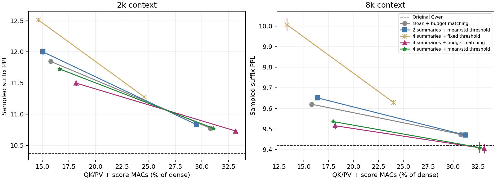

# 简化 p-bit 筛选指标：方法与结果对应（2026-10-07）

完成 166 组整模型评估和 4 组局部输出蒸馏训练。主要发现：四摘要最大值是本轮更好的简单评分；固定阈值存在明显预算漂移；按当前查询分数均值/标准差调整阈值，可用较低复杂度接近迭代预算匹配的效果。GPU 原型仍慢于 SDPA。

## 1. 方法编号

| 编号 | 指标生成 | 每块/每查询头的点积或网络 MAC |
|---|---|---:|
| A | 整块均值点积 → 块 softmax → 包含概率 | 64 |
| B | 整块均值点积 → sigmoid | 64 |
| C | 两个 32-token 子块均值点积，取最大值 | 128 |
| D | 四个 16-token 子块均值点积，取最大值 | 256 |
| E | 按 Query 符号选择逐维 Key min/max，然后点积 | 64 |
| F | 归一化均值与上界的非负组合；每头验证集选混合系数 | 128 |
| G | F 的混合系数、温度和阈值进一步做输出蒸馏 | 128 |
| 上一版 | 四摘要＋10→16→1 MLP | 432 |

MAC 不含比较、归约、指数、摘要维护、访存等。E 的两个极值向量需要额外读取；F 按两个点积计费，没有宣称缓存融合。C/D 保留多个代表信息时使用最大值，而非简单线性相加。

## 2. 协议和四种选块方式

Qwen2.5-0.5B Base 全部 24 层解码注意力启用筛选，原始 FFN/骨干不变，prefill 不变。块大小 64，强制保留首块和最近两块。两档预算 15%、30%。2k 使用 32×128=4096 评分 token；8k 使用 16×128=2048 token。随机配置 3 个种子，确定性 1 个。都是 WT2 测试集抽样后缀 PPL。

所有拟合/校准使用 WT2 train，末尾 65536 token 留作验证。每个上下文用于校准的验证查询只有 8 个，泛化能力有限。第一阶段 94 组；观察到预算漂移后增加迭代匹配 48 组，再增加轻量动态阈值 24 组。它们属于探索性连续实验，测试标签未用于拟合参数，仍需新的独立数据确认结论。

- **固定阈值 p-bit**：每层/头在验证集拟合温度和偏置，推理时不变。验证期望预算相同，不保证测试实际预算相同。
- **确定性**：排序选固定块数，作为指标排序质量对照；有 Top-K 开销，不是 p-bit 采样。
- **迭代匹配 p-bit**：每查询/每头做 16 次二分调整偏置，使期望保留 token 数匹配目标；实际采样块数仍随机。只用于判断预算漂移，并非廉价实现。
- **轻量动态阈值 p-bit**：对非强制块分数计算当前均值 μ 和标准差 σ，再用 sigmoid(((s−μ)/σ+c)/T) 采样。c/T 验证集校准，推理没有 MLP、块 softmax、排序或迭代求阈值。

## 3. 先比较指标排序：固定块数的确定性对照

| 方法 | 2k / 15% PPL | 2k / 30% PPL | 8k / 15% PPL | 8k / 30% PPL |
|---|---:|---:|---:|---:|
| B 均值＋sigmoid | 11.7537 | 10.7593 | 9.6113 | 9.4499 |
| C 两摘要最大值 | 11.6613 | 10.7590 | 9.6537 | 9.4804 |
| D 四摘要最大值 | 11.3819 | 10.6979 | 9.5394 | 9.3929 |
| E min/max 上界 | 12.2989 | 10.9648 | 9.8231 | 9.5380 |
| F 均值＋上界组合 | 11.7306 | 10.7260 | 9.5022 | 9.4251 |

原始 Qwen：2k **10.3736**，8k **9.4190**。确定性实际 token 比例约为 2k 15.2%/30.3%、8k 15.1%/29.9%，因为最后不完整块和块数取整。A 的非强制块排序与 B 相同，未重复确定性测试。少数 PPL 低于基线，不构成模型能力提升的证据。

## 4. 保持 p-bit：逐查询期望预算匹配

| 方法 | 2k / 15% PPL | 2k / 30% PPL | 8k / 15% PPL | 8k / 30% PPL |
|---|---:|---:|---:|---:|
| B 均值＋sigmoid | 11.8462 ± 0.0280 | 10.7756 ± 0.0093 | 9.6203 ± 0.0057 | 9.4739 ± 0.0125 |
| C 两摘要最大值 | 11.7565 ± 0.0172 | 10.7761 ± 0.0167 | 9.6686 ± 0.0077 | 9.4757 ± 0.0050 |
| D 四摘要最大值 | 11.4992 ± 0.0414 | 10.7305 ± 0.0182 | 9.5158 ± 0.0159 | 9.4052 ± 0.0232 |
| F 均值＋上界组合 | 11.8830 ± 0.0693 | 10.7892 ± 0.0287 | 9.5549 ± 0.0082 | 9.4525 ± 0.0192 |

这一阶段实测平均保留量接近 15%/30%，可较直接比较评分方法。四摘要最大值整体优于两摘要和均值，但没有证据表明所有头都需要四个摘要。± 为种子总体标准差，不是跨文档置信区间。

## 5. 为什么固定阈值会误导比较：8k，名义预算 30%

| 方法 | 固定阈值 p-bit PPL | 实际保留 token |
|---|---:|---:|
| A 均值＋块 softmax | 9.5071 | 25.98% |
| B 均值＋sigmoid | 9.6530 | 19.17% |
| C 两摘要最大值 | 9.6671 | 20.64% |
| D 四摘要最大值 | 9.6291 | 20.88% |
| E min/max 上界 | 9.6974 | 33.48% |
| F 均值＋上界组合 | 9.4991 | 25.58% |

这些行并非相同测试成本。尤其均值和最大值的固定阈值版本实际只保留约 19%–21%，不能用其较高 PPL 断言指标本身差。跨文本和逐层筛选造成的分布变化需要进一步研究。A 也是本轮按头校准的版本，不等同于此前名义预算 0.5 的旧均值配置。

## 6. 推荐继续研究的简化实现：当前分数均值/标准差调整阈值

| 方法 | 上下文 | 名义预算 | 实际保留 | PPL | QK/PV＋评分 MAC 占原 QK/PV |
|---|---:|---:|---:|---:|---:|
| C 两摘要最大值 | 2048 | 15% | 13.46% | 12.0013 ± 0.0528 | 15.05% |
| C 两摘要最大值 | 2048 | 30% | 27.90% | 10.8332 ± 0.0052 | 29.48% |
| C 两摘要最大值 | 8192 | 15% | 14.80% | 9.6513 ± 0.0052 | 16.37% |
| C 两摘要最大值 | 8192 | 30% | 29.67% | 9.4702 ± 0.0152 | 31.24% |
| D 四摘要最大值 | 2048 | 15% | 13.48% | 11.7236 ± 0.0237 | 16.65% |
| D 四摘要最大值 | 2048 | 30% | 27.94% | 10.7716 ± 0.0080 | 31.11% |
| D 四摘要最大值 | 8192 | 15% | 14.79% | 9.5362 ± 0.0059 | 17.93% |
| D 四摘要最大值 | 8192 | 30% | 29.53% | 9.4098 ± 0.0263 | 32.67% |

四摘要轻量动态阈值在 8k/30% 下 PPL 为 9.4098±0.0263，接近原模型9.4190，实际保留29.53%，相关MAC占32.67%。每块评分256 MAC，比此前432 MAC的MLP方案少约40.7%，但动态归约等操作未计入MAC。

2k/30% 下仍为10.7716，高于原始10.3736；测试保留量也降至27.94%。因此阈值泛化问题缓解但未消失。不能把8k结果外推到全部上下文或任务。

## 7. 输出蒸馏：保留失败结果

| 上下文 | 预算 | 初始验证输出 NMSE | 第1500步验证输出 NMSE | 最佳步数 |
|---|---:|---:|---:|---:|
| 2048 | 15% | 0.04484 | 0.04813 | 0 |
| 2048 | 30% | 0.01403 | 0.02241 | 0 |
| 8192 | 15% | 0.02507 | 0.03097 | 0 |
| 8192 | 30% | 0.00775 | 0.02126 | 0 |

4组训练都没有超过初始化，因此没有把新训练权重带入正式PPL测试。此次只训练简单混合系数、阈值、温度，使用直通估计和局部冻结教师输入，每上下文仅32个训练查询/头；不能据此否定更充分数据或端到端输出蒸馏。

## 8. GPU 计时：还没有比 SDPA 快

以下为8k、batch4、第12层真实Q/K/V快照，名义预算30%，独立预热后的串行计时。不是全模型每token延迟。摘要初始化不计，选择器包含一个用于重复同一步的额外末项减法。

| 方法/选择方式 | 选择器耗时 | 选择器＋稀疏核 |
|---|---:|---:|
| A 均值＋块 softmax / stochastic | 0.210 ms | 0.279 ms |
| B 均值＋sigmoid / stochastic | 0.184 ms | 0.259 ms |
| C 两摘要最大值 / stochastic | 0.263 ms | 0.331 ms |
| D 四摘要最大值 / stochastic | 0.270 ms | 0.336 ms |
| E min/max 上界 / stochastic | 0.195 ms | 0.267 ms |
| F 均值＋上界组合 / stochastic | 0.340 ms | 0.411 ms |
| C 两摘要最大值 / adaptive | 1.845 ms | 1.946 ms |
| D 四摘要最大值 / adaptive | 1.847 ms | 1.942 ms |
| F 均值＋上界组合 / adaptive | 1.923 ms | 2.046 ms |
| D 四摘要最大值 / deterministic | 0.241 ms | 0.311 ms |
| C 两摘要最大值 / moment | 0.363 ms | 0.445 ms |
| D 四摘要最大值 / moment | 0.367 ms | 0.449 ms |

同一计时中的 Qwen repeat_kv＋SDPA 约 0.160 ms。四摘要轻量阈值约0.449 ms，仍更慢；迭代匹配约1.942 ms尤其昂贵。减少矩阵运算不等于降低当前GPU延迟，尚需融合筛选、归约和稀疏读取，或验证真实p-bit硬件实现。

## 9. 文件与边界

- 源码：`experiments/router_metrics/`；本地开发分支：`pbit-router-metrics`。
- 远程：`/home/Hongjie_Zeng/pbit_router_metrics_20261007`。
- `summary.csv` / `summary.json`：70组配置汇总；`screen/`、`adaptive/`、`moment/`：166份原始评估。
- `distillation.json`：4次训练；`calibration.json`、`moment_calibration.json`：验证集拟合协议和结果。
- `kernel_checks.json`：摘要增量更新、分数上界与稀疏核数值检查；`benchmark.json`：24项计时。
- 小型参数本地备份于 `artifacts/router_metrics_20261007/`；教师张量留在远程。
- 本轮未测试学习低维投影、GQA共享门控、随机FFN联合替换或真实p-bit器件。完整KV容量未减少。

